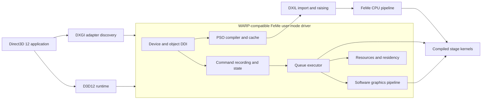
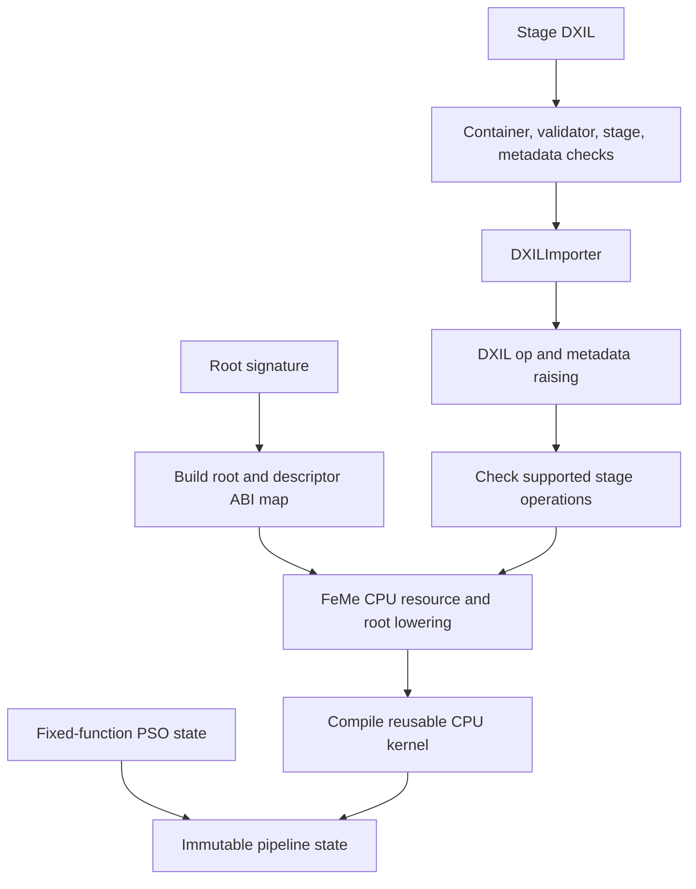

# FeMe Direct3D Software Adapter Design

## Status

The implementation now includes a portable, tested `FeMeDirect3D` plan library
for W1-W7 state normalization. Its 65 unit cases validate root signatures,
descriptor heaps, resource/subresource plans, barriers, graphics/blend/depth
state, advanced-graphics limits, DXR bounds, presentation contracts, and FL
12_2 capability gating, plus headless queue/wave/dispatch/copy/fence/object
plans, heap/residency/placed-resource/image-copy plans, draw/mesh dispatch,
viewport/scissor/IA layout, BLAS/TLAS
build policy, enhanced barriers and conformance release gating. It is
deliberately not itself a device implementation. A separate compiler-backed
application-local prototype now closes W0 and W1 with real stock-runtime
device creation, owned initialization/application shaders and pipelines,
KMD-backed buffers, typed queues/lists, asynchronous kernel-ordered compute
and copies, monitored fences, completed readback and pending teardown.
The W1 v1 inventory records the completed internal headless subset. W2 now
adds owned placed buffers, bounded aliases, whole-buffer alias barriers,
decreasing monitored fences, dispatch-only indirect commands and multiple
root CBVs, inline constants, finite CBV/raw/structured descriptor tables and
R32_UINT/R32_SINT/R32_FLOAT typed buffer views, two/four-component R32 SRVs
and buffer-command predication, plus checked structured-UAV counters and bounded
uint append/consume, typed SRV component mappings and narrow/packed SRVs;
pitched buffer-footprint copies and single-plane linear texture storage with
mip/array subresource copies;
inventory v20
explicitly marks W2 in progress.
General bindings/resources, graphics, ray traversal,
presentation and conformance remain W2-W7 work.

This design defines a full-featured Direct3D 12 software adapter using FeMe's
CPU target as its shader execution engine. The completed adapter targets the
same reference, compatibility, testing, headless, and software-rendering use
cases for which applications select the Windows Advanced Rasterization
Platform (WARP). Its product baseline is complete feature level 12_2 behavior,
including conventional graphics, mesh shading, variable-rate shading, sampler
feedback, and DXR 1.1, plus separately reported post-12_2 capabilities where
the selected Windows runtime and DDI expose them.

This is not a compute adapter with graphics left as an optional extension.
Compute-only bring-up remains a useful implementation checkpoint, but every
public interface, ABI, resource model, and scheduling decision must be
compatible with the completed graphics, presentation, and ray-tracing driver.
The adapter reports only capabilities which have reached their required
behavioral and validation threshold; the implementation plan may be staged,
but the architecture and product contract are full-featured from the outset.

This document uses "WARP replacement" as shorthand for that role. The selected
product contract is a WARP-compatible, application-local UMD drop-in using
stock Windows D3D12/DXGI, Microsoft's WARP adapter identity, and the existing,
unmodified WARP kernel-mode driver. This decision closes W0(b); it does not
claim that arbitrary applications can transparently load FeMe through the
Windows-owned `D3D_DRIVER_TYPE_WARP`/`IDXGIFactory4::EnumWarpAdapter` paths.
The current probe demonstrates application-local routing into an owned UMD
under WARP identity, but the loading boundary is not a documented general
third-party provider registration mechanism. Device/resource feasibility and
owned headless compute are now proven; a complete adapter and broad runtime
compatibility remain W2-W7 work. The implementation and validation are now
VM-first, per the 2026-11-17 development-flow change. System WARP binaries are not replaced,
and no new kernel-mode driver is in scope. A separately implemented
D3D12/DXGI COM runtime is not selected.

The shader compiler and execution machinery described in
[FeMeCPUDesign.md](FeMeCPUDesign.md) already imports DXIL and executes compute
shaders. The work designed here is the Direct3D/DXGI runtime, a software
graphics pipeline, and the FeMe CPU-target changes required to execute all
Direct3D shader stages. Like the expanded Vulkan ICD in
[FeMeVulkanDesign.md](FeMeVulkanDesign.md), the design includes complete
resource and synchronization semantics, rasterization, texture sampling,
format conversion, depth/stencil, blending, advanced shader stages, ray
tracing, and presentation interoperability.
The API-neutral core, CPU stage ABI, image/sampler, and software-executor
portions of that work are factored into
[FeMeGraphicsDesign.md](FeMeGraphicsDesign.md); this document owns their
Direct3D mapping and Windows deployment.

### Implementation baseline (2026-11-05)

The local Direct3D source evaluation and concise W0-W7 status are recorded in
[WARPRoadmap.md](WARPRoadmap.md); detailed progress and evidence are in
[WARPImplementationLog.md](WARPImplementationLog.md). At this historical
checkpoint no Direct3D implementation milestone was complete; W0 and W1
have since closed as recorded above.
The original compute-only compiler baseline is no longer current:

- `feme::cpu::CompiledStage` supports compute, vertex, fragment, hull,
  patch-constant, domain, geometry, mesh, and task invocation. Reuse its
  prepared resource and stage ABIs rather than inventing a Direct3D variant.
- `StageArtifactInfo` uses artifact ABI version 12 and populated wave,
  workgroup, and groupshared reflection. Divergent groupshared indexing has
  lowering and regression coverage; remaining barrier and masking limitations
  must be assessed against individual shaders, not treated as blanket gaps.
- Image and sampler descriptors, CPU sampling helpers, and a substantial
  `FeMeGraphics` raster/tessellation/mesh executor already serve the Vulkan
  ICD. Some reusable image layout, decoding, descriptor preparation, and
  scheduling machinery still lives in `lib/Vulkan`; extracting that machinery
  is a prerequisite to sharing it with Direct3D.
- Root-constant lowering accepts one binding at any register/space, bounded
  arrays, and dynamic row indices for homogeneous 16-/32-/64-bit integer
  and floating-point rows. Components are bounded against their array
  element and supplied root bytes, with overflow-safe offset arithmetic.
  Opt-in `--root-signature-constants` now selects one visible inline
  parameter from a checked root plan and refuses to promote descriptor-backed
  CBVs. Its full span/register/space remain reflected even if no cbuffer
  reads survive, including resource-free and mixed-heap compilation.
  Before normalization it checks live declarations in the entry/direct
  helper graph for class, space, visibility and complete containment in one
  root binding; adjacent ranges cannot collectively cover an array.
  Preflight also requires raw/structured buffers for root SRV/UAV descriptors;
  typed buffers and textures require tables. Live original native heap
  handles require the matching resource/sampler direct-index root flag;
  heap accesses generated for traditional bound emulation do not.
  Native opcode 140 and legacy opcode 69 raw/structured stores now raise
  contiguous masks 3/7/15 into packed two/three/four-component i32/FP32
  operations through existing CPU vector helpers. Scalar behavior is
  preserved; sparse/dynamic/oversized masks, packed non-32-bit types and
  mixed active fields remain unraised. Native SM6.6 heap and SM6.0 bound
  compute tests pass normal waves 4/8, reference and ARM64 AOT-object
  paths with exact bits, preserved field strides/sub-offsets, divergent
  masks, five lanes, guards and two repeats. Three-component writes use
  12 bytes; partly out-of-bounds vectors commit no words. Legacy AOT uses
  an explicit physical heap, not new object-mode binding materialization.
  Packed loads also raise: opcode 139 uses contiguous masks 1/3/7/15,
  keeping explicit widths for partial uses; legacy opcode 68 infers width
  only from complete leading-component uses. Packed i32/FP32 widths
  two/three/four retain existing vector-helper bounds without narrowing
  scalar support. Sparse/isolated-later legacy uses, invalid masks/types
  and status/aggregate uses stay unraised. Native SM6.6/SM6.0 tests cover
  exact-bit `Load2`/`Load3`/`Load4` and structured uint4/float3 fields,
  divergent uses, guards, last-valid and all-zero partial/large-address
  reads, and two repeats across the same CPU modes. A separate tail
  descriptor avoids legacy source-width coalescing; general legacy partial/
  coalesced-width semantics remain unproven. This changes DXIL raising,
  not runtime/SPIR-V implementation, status handling, artifact ABI 8,
  argument layouts or owned-device support.
  Native FP32 breadth additionally checks float2/float3/float4 structured
  loads and stores at offset 4 with strides 12/16/20 in SM6.6 heap and
  SM6.0 bound compute shaders across the same CPU modes. Negative zero,
  signed subnormals/infinities/quiet-NaN payloads and adjacent values near
  one retain their bits in copies without arithmetic. Partial final
  vectors and invalid indices read all zero; partial/invalid writes leave
  inputs unchanged. Five lanes, divergent copies, 732 guarded output
  bytes and two repeats pass, including 12-byte float3 stores. This adds
  native CPU copy/bounds evidence, not general FP32 arithmetic conformance,
  broader legacy admission or owned-device execution.
  Native raw/structured i32 atomics also check add/and/or/xor, signed/
  unsigned min/max, exchange and successful/failed compare-exchange
  across the same SM6.6/SM6.0 CPU modes. Existing getpointer/atomicrmw/
  cmpxchg and CPU helpers retain stride 12 and field offsets 4/8.
  Five lanes own independently initialized state; exact old values,
  high bits, UINT_MAX + 1 wraparound, divergent increments, invalid-
  address zero/no-op behavior and guards pass twice. This adds native
  buffer evidence, not contention/memory-order/barrier conformance,
  typed/image/int64 atomic breadth, owned-device support or new descriptor
  materialization. Runtime/SPIR-V code and ABI remain unchanged.
  Native typed R32_SINT/R32_UINT atomics additionally check all nine
  binary operations across the two formats, successful/failed compare-
  exchange, exact old values, wraparound, divergent increments and
  element-index bounds across the same CPU modes. Modern scalar/legacy
  atomic-only four-component fallback handles retain signedness; atomic
  exchange initializes lane-owned state. Guarded 28-byte state/464-byte
  output words pass twice. Legacy width inference is unchanged. This is not
  contention/order/barrier, other-format/image/int64 atomic or owned-
  device closure; runtime/SPIR-V code and ABI remain unchanged.
  Full-mask typed-store raising now closes the scalar-store gap found
  by that probe. Mask-15 i32/FP32 payloads through narrower handles
  retain all four channels in canonical vector stores, avoiding scalar
  helpers' 0/0/1 fills on wide descriptors. Handle width/signedness remain.
  Native SM6.6/SM6.0 scalar SINT/UINT/FP32 assignments pass R32/RGBA32
  cases across the same CPU modes, checking all broadcast channels,
  exact bits, divergent stores, invalid indices, texel guards and two
  repeats. Invalid/nonmatching partial masks, mixed types and non-32-bit
  promotion stay unraised. This adds native CPU store evidence, not
  general typed or owned-device closure; runtime/SPIR-V code, loads/
  status, atomics and ABI are unchanged.
  Native four-component typed loads now check SDK DXC SM6.6/SM6.0
  SINT/UINT/FP32 SRV/UAV shaders on nine R32/RGB32/RGBA32 formats across
  the same CPU modes. Valid R32 zero-G/B/one-alpha defaults and RGB32's
  real 12-byte stride/alpha one differ from all-zero incomplete/invalid
  loads, including alpha. Exact bits, valid-end accesses,
  divergent use, all input/output words, guards and two repeats pass.
  Distinct SRV/UAV data proves namespace separation; legacy AOT supplies
  physical heaps ordered by space/register/namespace. This is bounded
  shared CPU load/bounds evidence, not D3D12 view construction or general
  typed/owned-device closure; admission, status, runtime/SPIR-V code
  and ABI remain unchanged.
  Native scalar/vector-two typed loads additionally execute SDK DXC
  SM6.6/SM6.0 SINT/UINT/FP32 SRV/UAV shaders on matched R32/RG32
  formats and wider RGB32 descriptors at both widths across the same CPU
  modes. Modern properties/legacy uses recover narrow handles; existing
  helpers retain exact bits and RGB32's physical 12-byte stride.
  Incomplete RG32/RGB32 elements return zero; RGB32 missing Z is invalid
  even when R/G fit. Upper/negative bounds,
  namespace separation, valid-end accesses, divergence, all input/output
  words, guards and two repeats pass. AOT uses space/register/namespace-
  ordered physical heaps. This adds narrow CPU evidence, not D3D12 view
  construction or general typed/owned-device closure; admission, status,
  runtime/SPIR-V code and ABI remain unchanged.
  Typed-buffer opcode-72 field-zero dimensions now raise to
  `llvm.dx.resource.getdimensions.x` and lower to the existing CPU typed
  element-count helper. Complete physical texels are counted from descriptor
  byte size/format, not shader width. Unused/zero mip operands are accepted;
  other fields, aggregate uses and meaningful mips remain unraised.
  Native SDK DXC SM6.6/SM6.0 SINT/UINT/FP32
  SRV/UAV queries pass RGB32 and mixed R32/RG32/RGBA32 layouts across
  the same CPU modes, including partial/too-short views, namespaces,
  divergence, guards and repeats. Runtime/SPIR-V code, ABI 8 and argument
  layouts remain unchanged; no stores, advertisements, descriptor
  materialization or owned-device closure are added.
  Byte-address field-zero queries now also raise/lower to the existing raw
  metadata helper with stride one/prefix zero, returning bytes rather than
  DWORDs or structured elements. Native SDK DXC SM6.6/SM6.0 SRV/UAV
  queries pass namespaces, divergence, output query/store coexistence,
  guards and repeats across the same CPU modes. Odd-byte counts,
  metadata-only access and inactive/unbound/bounds zeros have runtime
  tests. Buffer xy fields remain unsupported.
  Runtime/SPIR-V code, ABI 8 and argument layouts remain unchanged;
  no advertisements, descriptor materialization or owned-device closure.
  Structured field-zero element counts now also raise/lower to the raw
  metadata helper with the handle's declared structure size as stride and
  prefix zero. DXC's constant HLSL stride result is preserved, not treated
  as a second DXIL dimension field. Native SM6.6/SM6.0 SRV/UAV queries
  pass 12/20-byte strides, partial/too-short views, namespaces, divergence,
  guards and repeats across the same CPU modes. Buffer xy fields and
  meaningful mips remain unsupported. Runtime/SPIR-V code, ABI 8 and
  argument layouts remain unchanged; this adds no descriptor materialization,
  advertisements or owned-device/conformance closure.
  Plain 2D heap-backed texture scalar/pair dimensions now lower to the
  existing CPU metadata width/height helper in any stage, without sampler
  or derivatives. FP32/i32 scalar/vector SRV/UAV queries pass native SDK
  DXC SM6.6 in waves 4/8, reference and ARM64 AOT, including width-only,
  height-only and paired results, a three-mip base extent, divergent/
  unbound indices, query/load coexistence, all words, guards and repeats.
  Sampled plain 2D explicit mips/counts use the separate path below.
  Non-32-bit declarations, aggregate
  uses and bound/static images remain outside this CPU path.
  Runtime/SPIR-V code, ABI 8 and layouts remain unchanged; this adds no
  descriptor materialization, advertisements or owned-device closure.
  Heap-backed 1D/array dimensions now share admission/lowering eligibility
  through existing metadata helpers with literal mip zero, no sampler or
  derivatives. Plain 1D accepts scalar width; array 1D accepts width or
  width/layer count. Native SDK DXC SM6.6 FP32/i32 SRV/UAV queries
  pass waves 4/8, reference and ARM64 AOT, including three-mip base
  widths, distinct layer counts, divergent/unbound indices, query/load
  coexistence, all words, guards and repeats. Portable fragment tests
  verify layer-derived loads and idempotence; plain 1D base-pair queries
  remain rejected. Explicit queries use the path below. Runtime/SPIR-V code, ABI 8 and
  layouts remain unchanged; no bound/static images, advertisements or
  owned-device closure are added.
  Sampled plain 2D explicit dimensions now preserve live i32 mips and total
  mip counts through `getdimensions.levels.xy`, symmetric LLVM forward/
  DXIL reverse lowering and shared CPU metadata helpers in any stage.
  Native SDK DXC SM6.6 passes waves 4/8, reference and ARM64 AOT for
  three valid mip extents, fixed counts, divergent/unbound indices,
  query-derived exact integer loads, all words, guards and repeats.
  Count-unused queries also execute. Writable/unsupported-shape/undefined-mip
  canonical forms reject; depth/aggregate uses remain unraised. Helper
  clamping is unchanged, with no native out-of-range-mip claim.
  Runtime/SPIR-V code, ABI 8 and layouts remain unchanged; no bound/
  static images, advertisements or owned-device closure are added.
  Sampled 1D-array explicit dimensions now use the same three-component
  intrinsic, preserving width/layers/count and the live mip. CPU lowering
  selects the existing 1D-array size helper plus shared total-level helper.
  Native SDK DXC SM6.6 passes waves 4/8, reference and ARM64 AOT for
  widths 7/3/1, two layers/three mips and widths 5/2, three layers/two
  mips, including exact query-derived SINT loads, divergent/unbound indices,
  skipped stores, every word, guards and repeats. Count-unused queries also
  execute. Writable explicit queries remain unsupported.
  Only valid mips are measured; helper clamping, runtime/SPIR-V code,
  ABI 8, layouts and advertisements are unchanged. No bound/static
  images or owned-device/conformance closure is added.
  Sampled plain 1D explicit dimensions now use `getdimensions.levels.x`,
  mapping width/count DXIL fields 0/3 to vector elements 0/1 through
  symmetric LLVM forward lowering and FeMe raising. Heap-backed FP32/i32
  CPU queries with defined i32 mips reuse existing 1D size/level metadata
  helpers without samplers or derivatives in any stage. Native SM6.6
  covers widths 7/3/1 with three mips and widths 5/2 with two mips,
  query-derived exact SINT loads, divergent/unbound indices, skipped stores,
  every word, guards and repeats in waves 4/8, reference and ARM64 AOT.
  Count-unused queries execute. Writable/undefined-mip and mismatched-shape
  canonical queries reject; base 1D pairs remain unsupported. Only valid
  native mips are measured; helper clamping, runtime/SPIR-V code, ABI 8,
  layouts and advertisements remain unchanged. No owned-device closure.
  Heap-backed sampled plain-cube FP32/i32 dimensions now accept base
  scalar/pair and explicit width/height/mip-count queries through existing
  2D size-at-LOD and total-level helpers. Raising preserves live mips and
  DXIL field-3 counts through `getdimensions.levels.xy`; existing LLVM
  forward lowering is reused. Queries need no sampler or derivatives in
  any stage. Native SM6.6 passes waves 4/8, reference and ARM64 AOT
  without a sampler heap and with query-derived explicit-LOD sampling,
  covering base 4x4, three valid face extents, distinct counts, divergence/
  unbound zeros, skipped stores, all words, guards and repeats. Writable
  cubes and undefined-mip canonical forms reject. Only valid
  native mips are measured; helper clamping, runtime/SPIR-V code, ABI 8,
  layouts and advertisements remain unchanged. No owned-device closure.
  Heap-backed FP32/i32 2D-array dimensions now accept base scalar/pair/
  triple SRV/UAV queries and sampled explicit width/height/layers/mip-count
  queries. New xyz/levels.xyz intrinsic forms preserve DXIL fields 0/1/2/3
  through symmetric LLVM forward lowering and FeMe raising. CPU lowering
  reuses existing array size/level metadata helpers in any stage without
  sampler/derivatives. Layers stay fixed as mip extents shrink. Native
  SM6.6 passes waves 4/8, reference and ARM64 AOT for base/explicit
  sampled and base writable queries, exact query-derived SINT loads,
  divergence/unbound zeros, skipped stores, all words, guards and repeats.
  Writable explicit, undefined-mip and mismatched-shape canonical queries
  reject; MS dimensions use the separate path below. Only valid native
  mips are measured; helper clamping, runtime/SPIR-V code, ABI 8, layouts
  and advertisements are unchanged. No owned-device closure is established.
  Heap-backed FP32/i32 3D dimensions accept base x/xy/xyz SRV/UAV queries
  and sampled levels.xyz with defined i32 mips. Existing intrinsic forms
  preserve width/height/depth and a separate total mip count; existing 3D
  size-at-LOD and shared level helpers need no sampler/derivatives in any
  stage. Depth shrinks with mip, unlike fixed array layers. Native SM6.6
  passes waves 4/8, reference and ARM64 AOT, each repeated twice,
  checking all 916 bytes, exact query-derived SINT loads, divergent/
  unbound indices, skipped stores and guards. Writable explicit, undefined-
  mip and wrong result-form queries reject. Only valid native mips are
  measured; runtime/SPIR-V code, helper clamping, ABI 8, advertisements and
  layouts remain unchanged. This adds no owned-device/conformance closure.
  Heap-backed sampled FP32/i32 cube-array dimensions accept base x/xy/xyz
  and levels.xyz with defined i32 mips. Existing intrinsic forms and
  cube-array size/level metadata helpers return face width/height, fixed
  cube element count (`ArrayLayers / 6`) and total mip count, without
  sampler/derivatives in any stage. Native query-only and query-derived
  sampling variants pass waves 4/8, reference and ARM64 AOT, each repeated
  twice, checking all 656/736 bytes, divergence/unbound zeros, skipped
  stores and guards. Queried counts select the last cube and reverse two
  real mips. Writable cube arrays, undefined mips and wrong result forms
  reject. Only valid native mips are measured; runtime/SPIR-V code, helper
  clamping, ABI 8, advertisements and layouts remain unchanged. This adds
  no owned-device/conformance closure.
  Heap-backed sampled FP32/i32 2DMS/array dimensions use new samples.xy/
  xyz forms without a mip operand for width/height, optional fixed layers
  and sample count. DXIL field 3 maps to sample count, not total mip count,
  through symmetric LLVM forward lowering and FeMe raising. Count-unused
  queries use x/xy/xyz. Existing size/sample-count metadata helpers need
  no sampler/derivatives in any stage. Native SM6.6 passes waves 4/8,
  reference and ARM64 AOT, each repeated twice, checking all 332 bytes,
  query-derived FP32/exact SINT sample loads, divergence/unbound zeros,
  skipped stores and guards. Writable/non-heap/non-32-bit, wrong result
  forms, samples-on-non-MS and levels-on-MS queries reject. Runtime/
  SPIR-V code, existing load/store/status/atomic policy, ABI 8, layouts
  and advertisements remain unchanged. This adds no resolve or owned-
  device/conformance closure.
  Three-component i32/FP32 typed CPU loads now reuse vector-four helpers
  and select XYZ via shared texel-result narrowing, avoiding nonexistent
  `v3` helpers while retaining physical stride/complete-texel bounds.
  Portable i32/FP32 regressions and native SM6.6/SM6.0 FP32 SRV/UAV
  RGB32/RGBA32 cases check XYZ order, 12-byte stride, W discard,
  incomplete/invalid all-zero reads, exact bits, namespace separation,
  valid-end accesses, divergence, guards and two repeats. Image/raw/non-
  32-bit paths, raising, stores, status, runtime/SPIR-V code and ABI are
  unchanged. Broader format and owned-device closure are not established.
  Native integer-three typed loads now execute SDK DXC SM6.6/SM6.0
  `int3`/`uint3` SRV/UAV shaders on RGB32/RGBA32 SINT/UINT across
  the same CPU modes. Shared RGB32 integer decoding now preserves exact
  bits at a real 12-byte stride and supplies alpha one; typed narrow/wide
  reads, complete-element dimensions, integer image loads and fixed-alpha
  borders have runtime tests. XYZ order, distinct-W discard, all-zero
  incomplete/invalid loads, namespace separation, divergence, guards and
  repeats pass natively. RGB32 integer typed stores remain tested no-ops;
  Vulkan advertisements, raising/lowering, status, SPIR-V code, ABI 8 and
  argument layouts remain unchanged. General typed-format and owned-device
  closure remain open.
  Visible static samplers must match the declared default/comparison mode:
  minimum/maximum filters remain default, not comparison filters.
  Descriptor-table and native-heap sampler contents are not validated.
  Legacy sampler metadata now preserves default/comparison modes and
  reconstructs canonical handles through the existing cast bridge. Real
  native DXC shaders therefore reach static-mode preflight. Valid/inferred
  linkage still fails unsupported bound descriptors or comparison access;
  no new sampler descriptor materialization or execution is established.
  Scalar FP32 `SampleCmpLevelZero` now has matching LLVM opcode-65
  lowering and checked FeMe raising, including real forward/reverse and
  native DXC evidence. Valid bound comparison access reaches descriptor
  admission. Heap-backed scalar FP32 1D/2D/cube level-zero comparison, including
  array forms, now executes through shared CPU image helpers in JIT/reference/AOT modes,
  with constant texel offsets and reflected sampler-heap usage.
  Plain 1D uses scalar U/offset; array coordinates add a separate FP32
  layer component (second for 1D, third for 2D). Offsets remain spatial
  and use the existing shared sampling runtime.
  Cubes use three FP32 direction components and an optional fourth
  cube-array element coordinate; unused scalar offsets are poison/undef
  or zero, never passed to the shared cube comparison helper.
  Scalar FP32 implicit `SampleCmp` now has checked opcode-64 forward/reverse
  mapping, including preserved real zero/nonzero/dynamic MinLod clamps.
  Undefined/poison clamps select the plain canonical intrinsic.
  Six-shape LLVM roundtrips and native SDK DXC pixel-shader import pass.
  Heap-backed scalar FP32 1D/2D/cube implicit comparison, including arrays, executes in
  compiled fragment stages through shared helpers, with real coarse quad
  spatial/direction derivatives, implicit LOD, supported offsets and the optional shader
  MinLod clamp. Tests distinguish mip 1 from explicit zero and clamped mip 2,
  including helper lanes, partial waves, guards and repeated invocation.
  Array layers remain separate from the U/V derivatives and signed spatial
  offsets. Complementary layer depths, divergent layers/references and dynamic
  zero/two clamps make wrong layer/mip selection observable. Missing-layer
  coordinates still reject; native DXC plain/clamped array import is tested.
  Plain 1D uses scalar U/offset; 1D arrays add a separate FP32 layer.
  Only U is differentiated. Compiled plain/array tests distinguish implicit,
  explicit-zero and shader-clamped mips with X- and Y-derived footprints,
  divergent layers/references, dynamic clamps and guarded partial waves.
  Native DXC plain/clamped 1D/array import is tested; ordinary DXIL 1D
  sampling/loading eligibility remains unchanged.
  Cubes differentiate all three raw direction components; their six derivatives
  feed the existing cube projection/LOD runtime. The fourth cube-array
  coordinate is never differentiated; unused scalar offsets accept
  poison/undef or zero only. Combined compiled execution tests all six faces,
  both cube elements and both screen derivative axes, dynamic clamps,
  helper lanes and guarded partial waves. Native DXC plain/clamped cube/array
  import is tested, not bound execution.
  Compute/unannotated stages and other shapes still fail explicit
  admission; no implicit LOD is replaced with zero. Other dimensions,
  dynamic/undefined spatial offsets, broader comparison conformance and half/vector
  results remain open;
  no bound/static descriptor
  materialization or owned D3D12 execution is established.
  FP32 `SampleBias` now has checked opcode-61 import/raising against LLVM's
  existing forward lowering for 1D/array, 2D/array, 3D and cube/array textures.
  Scalar and two-/three-/four-component FP32 texels and default samplers
  are supported. Bias, spatial offsets and real MinLod clamps survive;
  undefined/poison clamps select the plain intrinsic. Status/aggregate uses
  and malformed calls stay unraised without an extra sample. Seven-shape
  roundtrips, idempotence and native DXC pixel-shader import pass.
  Heap-backed FP32 1D/2D/3D/cube biased sampling, including arrays, now executes
  in compiled fragment stages with real coarse spatial/direction derivatives,
  implicit LOD, bias, supported offsets and optional shader MinLod clamps.
  Scalar/vector results up to the
  declared texel width (at most four) narrow the shared four-component result.
  Shared admission/signature growth/lowering, sampler reflection and dead
  handle cleanup are tested. Compiled execution checks both derivative axes,
  mip/texel/component selection, divergent bias/clamps, helpers, partial waves
  and guarded repeats. Compute/unannotated stages, other shapes, non-heap
  handles, comparison samplers and dynamic/undefined spatial offsets reject explicitly;
  normal/reference/AOT compute rejection is tested. This does not materialize
  descriptors or establish owned D3D12 execution.
  Biased 2D array sampling passes a separate third FP32 layer coordinate;
  only U/V are differentiated and the two signed offsets remain spatial.
  Distinct layer/mip/texel/component values, divergent layers/bias/clamps,
  helpers and guarded partial waves are tested. Missing-layer coordinates
  and compute/unannotated array access still reject explicitly.
  Cubes supply six raw-XYZ derivatives to the existing face-projection/LOD
  runtime; the separate cube-array element is never differentiated. Unused
  scalar offsets accept poison/undef or zero only. All six faces, both
  elements, biased/clamped mip selection, components and guarded partial
  waves are tested. Nonzero/dynamic cube offsets remain unsupported.
  Biased 1D sampling uses scalar U and a constant signed scalar i32 offset.
  Arrays add a separate second layer coordinate; only U is differentiated
  and the offset remains spatial. Compiled tests check mip-0/mip-1
  footprints, both derivative axes, layer/mip/texel/component values,
  divergent layers/bias/clamps and guarded partial waves. Malformed
  coordinates and dynamic/poison/undefined 1D offsets reject. Implicit DXIL
  1D sampling outside fragment stages and non-32-bit 1D/array loading remain unsupported.
  Biased 3D sampling passes FP32 (U, V, W), six coarse spatial derivatives
  and three constant signed i32 offsets to the existing shared 3D helper.
  Compiled tests isolate each coordinate's LOD contribution on both screen
  axes, signed XYZ offsets, biased/clamped mips and result components with
  guarded partial waves. Malformed coordinates/offset widths and dynamic or
  partially undefined offsets reject. Implicit DXIL 3D sampling outside
  fragment stages and non-32-bit 3D loading remain unsupported. Seven-shape fragment
  biased execution is bounded compiler/executor coverage, not descriptor
  materialization or owned-device execution.
  Heap-backed FP32 cube/array `SampleLevel` now uses shared checked
  admission/lowering in any stage with default samplers, FP32 direction/
  array-element coordinates, FP32 LOD and result widths one through four
  up to the declared texel width. Cubes retain an unused scalar zero/
  undef/poison offset. Helpers receive live explicit LOD, six zero
  derivatives, zero bias, separate elements and no shader MinLod clamp.
  All `SampleLevel` calls now avoid the legacy implicit-only fallback;
  malformed coordinates/offsets, comparison samplers, non-heap handles,
  non-FP32 texels and too-wide results reject consistently. Transforms/
  admission verify placeholders, narrowing, reflection and idempotence.
  Compiled fragments check six faces, two cubes, three mips, spatial/
  components, all widths, helpers, masks, partial waves, guards and repeats.
  Native DXC cube/plain-array shaders execute two mips, exact FP32-bit
  half-mip blends and image/sampler clamps through normal waves 4/8,
  reference and ARM64 AOT-object paths. Other sampling, runtime/SPIR-V
  lowering, ABI 8 and argument layouts are unchanged; no owned D3D12
  execution or W2(a)/W2(b)/W3(b) closure is added.
  Heap-backed FP32 2D/array `SampleLevel` now uses shared checked
  admission/lowering in any stage with default samplers, FP32 U/V or
  U/V/layer coordinates, FP32 LOD, constant signed XY offsets and results
  up to the declared texel width (one through four). Helpers receive live
  explicit LOD, zero derivatives/bias, separate layers and no shader
  MinLod clamp. Malformed shapes/offsets, comparison samplers, non-heap
  handles, non-FP32 texels and too-wide results reject, including through
  the old zero-offset fallback. Transforms/admission check forwarding,
  narrowing, reflection, idempotence and every-stage invalid offsets.
  Compiled fragment arrays cover all widths, mips/layers/coordinates,
  helpers, masks, partial waves, guards and repeats. Native DXC plain/
  array shaders execute three rectangular mips, signed/omitted offsets,
  half-mip blends and sampler clamps through normal/reference/AOT-object
  paths with waves 4/8. Implicit 2D/cube sampling, runtime/SPIR-V
  lowering, artifact ABI 8 and argument layouts are unchanged; no owned
  D3D12 execution or W2(a)/W2(b)/W3(b) closure is added.
  Heap-backed FP32 1D/array `SampleLevel` now executes in any stage with
  default samplers, scalar U or `(U,layer)` coordinates, constant signed
  scalar offsets and scalar/vector results up to the declared texel width
  (at most four). Explicit LOD survives with zero derivatives/bias; existing
  sampler LOD behavior is unchanged. Compiled fragment and normal/reference
  compute tests verify multi-mip/layer selection, offsets, components,
  sampler clamps, helpers, partial waves, guards and repeats. Native SDK
  DXC bindless 1D/array shaders execute through normal/reference/AOT paths
  with three real mips of widths 5/2/1 and two fixed layers, retaining
  original one-mip coverage. New exact FP32-bit checks cover signed/
  omitted offsets, components/layers, negative/upper LOD, half-mip blends
  and sampler clamps at mip 1, with waves 4/8, guards and repeat 2.
  Malformed shapes,
  non-heap handles, comparison samplers and dynamic/undefined/poison offsets
  remain rejected. This does not change other ordinary shapes or
  materialize bound/static descriptors.
  Owned D3D12 execution and W2/W3 closure remain open.
  Heap-backed FP32 3D `SampleLevel` now also executes in any stage with
  default samplers, three-component U/V/W coordinates, FP32 LOD, constant
  signed XYZ offsets and scalar/vector results up to the declared texel
  width (at most four). Explicit LOD survives with six zero derivatives
  and zero bias; existing sampler LOD behavior is unchanged. Compiled
  fragment and normal/reference compute tests verify multi-mip selection,
  offsets, components, sampler clamps, helpers, partial waves, guards and
  repeats. Native SDK DXC bindless 3D shaders execute through normal/
  reference/AOT paths with three rectangular mips of extents 4x2x2,
  2x1x1 and 1x1x1, retaining original one-mip coverage. New exact FP32-bit
  checks cover shrinking depth, signed/omitted XYZ offsets, components,
  negative/upper LOD, half-mip blends and sampler clamps at mip 1, with
  waves 4/8, guards and repeat 2.
  Malformed shapes, non-heap handles, comparison samplers and dynamic/
  undefined/poison or partially undefined offsets remain rejected.
  Non-fragment implicit 3D sampling, non-32-bit 3D loading and other ordinary shapes
  are unchanged.
  No bound/static descriptor materialization or owned D3D12 execution is added.
  Heap-backed FP32 3D `Load` now executes in any stage with three-component
  i32 XYZ coordinates, an i32 mip, constant signed XYZ offsets and scalar/
  vector results up to the declared texel width (at most four). Offsets
  become wrapping integer coordinate adds; the volume helper receives
  explicit mip, sample zero and no sampler/derivatives. Native DXIL's
  all-undefined omitted 3D offset raises to zero; partially undefined
  offsets stay rejected. Bounds now use
  all three per-mip extents, preventing higher-mip X/Y aliasing; negative/
  out-of-range coordinates and invalid mips read zero. Compiled normal/
  reference compute tests cover distinct mips/XYZ/components, all result
  widths, offsets, bounds, partial waves, guards and repeats. Fragment
  tests add divergent mips and helper masks. Native SDK DXC bindless
  shaders execute through normal/reference/AOT paths on one mip.
  Malformed shapes, non-heap handles, non-32-bit texels and dynamic/undefined/
  poison offsets remain rejected. Other loading/sampling, SPIR-V lowering,
  artifact ABI 8 and argument layouts are unchanged. Bound/static
  descriptors, owned D3D12 execution and W2(a)/W2(b)/W3(b) remain open;
  `CreateDevice` remains `E_NOTIMPL`.
  Heap-backed signed/unsigned i32 3D `Load` now also executes in any stage
  with the same coordinate/mip/offset rules and widths one through four.
  Result scalar types must match the texel; the integer helper preserves
  exact bits without FP32 conversions. All three per-mip extents and
  invalid mips are checked before fetching; invalid accesses read zero.
  Compiled normal/reference compute tests distinguish high-bit/negative
  values, mips, XYZ and components, all result widths, offsets, bounds,
  partial waves, guards and repeats. Fragment tests add integer outputs,
  divergent mips and helper masks. Native SDK DXC `int4`/`uint4` shaders
  execute through normal/reference/AOT paths on one mip. Mixed scalar
  types, non-32-bit texels, too-wide results, non-heap handles and dynamic/
  undefined/poison offsets remain rejected. Existing FP32 loads, sampling,
  other dimensions, SPIR-V lowering, artifact ABI 8 and argument layouts
  are unchanged; existing SPIR-V integer loads share the runtime bounds
  correction. Bound/static descriptors, owned D3D12 execution and
  W2(a)/W2(b)/W3(b) remain open; `CreateDevice` remains `E_NOTIMPL`.
  Heap-backed FP32 1D/array `Load` now executes in any stage with scalar
  i32 X or paired `(X,layer)` coordinates, an i32 mip, constant signed
  scalar spatial offsets and scalar/vector FP32 results up to the texel
  width (one through four). Wrapping adds offset only X; layers remain
  separate. Existing helpers need no sampler/derivatives. Native omitted
  undefined/poison spatial offsets normalize to zero; canonical dynamic/
  undefined/poison offsets reject. Runtime checks per-mip width, invalid
  mips and independent layer bounds, returning zero instead of aliasing
  another subresource; SPIR-V FP32 users share the runtime correction.
  Compiled normal/reference compute tests distinguish three mips, layers,
  X and components with all result widths, offsets, bounds, partial waves,
  guards and repeats. Fragment tests add divergent mips/layers and helper
  masks. Native SDK DXC shaders execute through normal/reference/AOT paths
  on one mip. Non-32-bit 1D/array loads remain unsupported. Existing 3D loads,
  sampling, SPIR-V lowering, artifact ABI 8 and argument layouts are
  unchanged. Bound/static descriptors, owned D3D12 execution and
  W2(a)/W2(b)/W3(b) remain open; `CreateDevice` remains `E_NOTIMPL`.
  Heap-backed signed/unsigned i32 1D/array `Load` now also executes in any
  stage with the same coordinate/mip/offset rules and widths one through
  four. Matching result/texel scalar types and existing integer helpers
  preserve exact bits without FP32 conversions. Per-mip width, invalid
  mip and independent layer checks now match FP32, returning zero for
  invalid accesses; SPIR-V integer users share the runtime correction.
  Compiled normal/reference compute tests distinguish high-bit/negative
  and adjacent non-FP32-exact components, three mips, layers and X with
  all result widths, offsets, bounds, partial waves, guards and repeats.
  Fragment tests add integer outputs, divergent mips/layers and helper
  masks. Native SDK DXC plain/array `int4`/`uint4` shaders execute through
  normal/reference/AOT paths on one mip. Mixed scalar types, non-32-bit
  texels, too-wide results, non-heap handles and dynamic/undefined/poison
  offsets remain rejected. Existing FP32 loads, 3D loads, sampling,
  SPIR-V lowering, artifact ABI 8 and argument layouts are unchanged.
  Bound/static descriptors, owned D3D12 execution and W2(a)/W2(b)/W3(b)
  remain open; `CreateDevice` remains `E_NOTIMPL`.
  The existing heap-backed FP32 2D/array `Load` path now shares
  stage-independent admission/lowering with paired `(X,Y)` or
  three-component `(X,Y,layer)` i32 coordinates, an i32 mip, constant
  signed XY offsets and scalar/vector results up to the declared FP32
  texel width (one through four). Wrapping adds offset only X/Y; layers
  stay separate. Existing helpers need no sampler/derivatives. The old
  zero-offset-only fallback is removed. Malformed coordinates, padded
  array offsets, integer/non-FP32 texels, too-wide results, non-heap
  handles and dynamic/undefined/poison or partial offsets reject.
  Native omitted undefined/poison XY offsets raise to zero; canonical
  offsets remain strict. Per-mip spatial extents, invalid mip and
  independent layer checks return zero for invalid accesses; SPIR-V FP32
  users share the runtime bounds correction. Compiled normal/reference
  compute tests distinguish rectangular mips, X/Y, layers/components,
  all result widths, offsets, bounds, partial waves, guards and repeats;
  fragment tests add divergent mips/layers and helper masks. Native SDK
  DXC plain/array shaders execute through normal/reference/AOT paths on
  one, two and three real mips. The 5x3/2x1/1x1 chain retains two fixed
  layers and checks exact negative quarter-valued FP32 bits, signed/
  omitted offsets, first/last texels and all lower/upper X/Y/layer/mip
  bounds, with normal waves 4/8, five lanes, guards and repeat 2.
  Existing 1D/3D loads, sampling, SPIR-V lowering,
  artifact ABI 8 and argument layouts are unchanged. Bound/static
  descriptors, owned D3D12 execution and W2(a)/W2(b)/W3(b) remain open;
  `CreateDevice` remains `E_NOTIMPL`.
  Heap-backed signed/unsigned i32 2D/array `Load` now also executes in any
  stage with matching result/texel scalar types, widths one through four
  and the same coordinate/mip/offset rules. Integer helpers and shared
  narrowing preserve exact bits without FP32 conversions. Integer
  per-mip X/Y, invalid mip and independent layer checks match FP32,
  returning zero for invalid accesses; SPIR-V integer users share the
  runtime correction. Compiled normal/reference compute tests verify
  high-bit/negative and adjacent non-FP32-exact components, rectangular
  mips, X/Y/layers, all result widths, offsets, bounds, partial waves,
  guards and repeats. Fragment array tests add integer outputs,
  divergent mips/layers and helper masks. Native SDK DXC plain/array
  `int4`/`uint4` shaders execute through normal/reference/AOT paths on one,
  two and three real mips. The 5x3/2x1/1x1 chain retains two fixed layers
  and checks exact integer bits, signed/omitted offsets, first/last
  texels and all lower/upper X/Y/layer/mip bounds, with normal waves 4/8,
  five lanes, guards and repeat 2.
  Mixed scalar types, non-32-bit texels, too-wide results, non-heap
  handles and dynamic/undefined/poison or partial offsets reject.
  Existing FP32 loads, 1D/3D loads, sampling, SPIR-V lowering, artifact
  ABI 8 and argument layouts are unchanged. Bound/static descriptors,
  owned D3D12 execution and W2(a)/W2(b)/W3(b) remain open;
  `CreateDevice` remains `E_NOTIMPL`.
  Heap-backed FP32 `Texture2DMS::Load`/`Texture2DMSArray::Load` now execute
  in any stage. Native `dx.MSTexture` opcode 66 raises to
  `llvm.dx.resource.load.ms`, keeping the sample index separate from the
  integer coordinates and signed XY offsets. Shared matching retains
  FP32 scalar/vector widths one through four and heap-backed handles.
  Existing 2D/array helpers receive mip zero, the live sample and separate
  layers without samplers or derivatives. FP32 runtime sample bounds now
  prevent invalid samples from aliasing another texel/row/layer; SPIR-V
  FP32 users share this correction without lowering changes. Compiled
  normal/reference compute and fragment array tests cover samples,
  components, offsets, bounds, helper masks, partial waves, guards and
  repeats. SDK DXC FP32 plain/array shaders pass import/raising and
  normal/reference/AOT execution with runner MS YAML.
  Integer MS execution is covered below.
  MS sampling and dynamic/undefined/poison or partial offsets remain
  unsupported. Bound/static
  descriptors and owned D3D12 execution remain open. Artifact ABI 8 and
  argument layouts are unchanged; `CreateDevice` remains `E_NOTIMPL`;
  W2(a)/W2(b)/W3(b) are not closed.
  Heap-backed signed/unsigned i32 MS `Load` now also executes in any stage
  with matching scalar types, widths one through four and the same
  coordinate/sample/offset rules. Integer helpers preserve exact bits
  with mip zero, live samples and separate layers. Runtime sample bounds
  now match FP32, preventing aliasing another texel/row/layer; SPIR-V
  integer users share the correction. Runtime and compiled
  normal/reference compute tests distinguish exact components, samples,
  coordinates/layers, offsets and bounds, partial waves, guards and
  repeats; fragment array tests add integer outputs, divergent samples/
  layers and helper masks. SDK DXC `int4`/`uint4` shaders pass native
  import/raising and normal/reference/AOT execution with runner MS YAML.
  Mixed scalar types, non-32-bit texels, too-wide
  results, non-heap handles and dynamic/undefined/poison or partial offsets
  remain rejected. Native raising, FP32 MS/single-sample loads, sampling,
  artifact ABI 8 and argument layouts are unchanged. Bound/static
  descriptors, owned D3D12 execution and
  W2(a)/W2(b)/W3(b) remain open; `CreateDevice` remains `E_NOTIMPL`.
  Runner YAML accepts `2d-ms`/`2d-ms-array` with a positive `sample-count`
  and checked one-mip sample-interleaved layouts. Native SDK DXC
  FP32/SINT/UINT plain/array MS shaders execute through normal/reference/
  AOT-object paths with distinct samples, rows/layers/components,
  offsets, bounds, partial waves, guards and repeats. Invalid YAML
  counts/extents/layers, overflow and host allocation limits are errors.
  This does not advertise D3D12 MSAA quality or materialize owned
  bound/static descriptors. MS images retain one mip; owned-device
  execution remains open; artifact ABI 8 and argument layouts are unchanged.
  Runner image YAML also accepts `mip-levels`, default 1, in [1, 32] for
  non-MS dimensions. Checked mip-major layouts halve/clamp nonzero
  spatial extents and 3D depth, retain fixed array/cube layers and check
  cumulative offsets before allocation. Single-mip defaults, zero-fill
  and repeated-dispatch ownership remain unchanged. Canonical all-path
  tests cover non-power-of-two mips, 1D/2D arrays, 3D depth, mip 31,
  trailing zero-fill and cube/array half-mip blending. Native SDK DXC
  FP32/SINT/UINT 2D/plain-array fixtures execute three mips with extents
  5x3/2x1/1x1 and fixed layers, retaining one/two-mip regressions.
  Exact negative/fractional FP32 and integer bits check signed/omitted
  offsets, first/last texels/components and all lower/upper X/Y/layer/
  mip bounds, with normal waves 4/8, five lanes, guards and repeat 2.
  Native FP32/SINT/UINT 1D/plain-array and 3D load fixtures
  also execute three mips through normal/reference/AOT-object paths.
  Widths 5/2/1 keep fixed array layers; 3D extents 4x2x2/2x1x1/1x1x1
  shrink depth. Signed offsets select first/last texels and components;
  invalid X/layers/mips and upper XYZ bounds read zero. Native raising,
  exact integer bits, waves 4/8, five lanes, guards and repeat 2 pass.
  Original one-mip coverage remains; no implementation change was needed.
  Image-binding preparation is tested without bound-image
  execution. CPU storage counts are not D3D12 mip/format support;
  owned-device gaps, artifact ABI 8 and argument layouts are unchanged.
  Heap-backed FP32 3D implicit `Sample` now executes in fragment stages
  with default samplers, three-component U/V/W coordinates, constant signed
  XYZ offsets and scalar/vector results up to the declared texel width (at
  most four). Six real coarse spatial derivatives drive LOD with zero
  shader bias and no shader MinLod clamp. Compiled tests isolate signed
  U/V/W derivatives on both screen axes for mips 0/1/2, signed offsets,
  all four result widths, helpers, partial waves, guards and repeats.
  Native SDK DXC pixel shaders pass import/raising; real shader-clamped
  variants remain unraised. Non-fragment calls and malformed/dynamic/
  undefined/poison offsets remain rejected, including normal/reference/
  AOT compute admission. Non-32-bit DXIL 3D loading, other sampling, SPIR-V, artifact
  ABI 8 and argument layouts are unchanged. Bound/static descriptors,
  owned D3D12 execution and W2(a)/W2(b)/W3(b) remain open;
  `CreateDevice` remains `E_NOTIMPL`.
  Heap-backed FP32 1D/array implicit `Sample` now executes in fragment
  stages with default samplers, scalar U or `(U,layer)`, constant signed
  scalar offsets and scalar/vector results up to the declared texel width
  (at most four). Real coarse U derivatives select LOD with zero shader
  bias; array layers remain undifferentiated. Compiled tests verify both
  signed screen-axis derivatives, mips 0/1/2, layers, offsets, components,
  helpers, partial waves, guards and repeats. Native SDK DXC plain/array
  pixel shaders pass import/raising; real shader-clamped variants remain
  unraised. Non-fragment calls and malformed/dynamic/undefined/poison offsets
  remain rejected, including normal/reference/AOT compute admission.
  Other ordinary shapes and explicit LOD are unchanged.
  No bound/static descriptor materialization or owned D3D12 execution is added.
  FP32 `SampleGrad` now has checked opcode-63 import/raising against LLVM's
  existing forward lowering for all seven sampled texture shapes. Scalar/
  vector FP32 texels up to four components use default samplers. Coordinates/
  layers, spatial gradients, signed/dynamic spatial offsets and optional
  real MinLod clamps survive; gradient width excludes array layers.
  Undefined/poison clamps select the plain intrinsic. Shared bias/gradient
  guards check operand types, complete results and every result use before
  adding a sample; malformed calls and unsupported status/aggregate uses
  stay unraised without an extra read. Seven-shape roundtrips, raw guards,
  idempotence and native DXC plain/clamped import pass. Heap-backed FP32
  1D/2D/3D/cube gradients (including arrays) execute in any stage with default
  samplers, shape-matched coordinates/gradients and optional shader clamps.
  1D/2D/3D use constant signed offsets; cubes require an unused zero/undef/poison
  scalar offset. Scalar/vector results cannot exceed the declared texel
  width (at most four). Array elements remain coordinate-only, excluded
  from scalar U, U/V or raw-direction gradients. 1D gradients/offsets are
  scalar; 3D coordinates, gradients and offsets have three U/V/W components.
  Supplied derivatives drive existing
  LOD/projection helpers without synthesized derivatives or an LOD-zero
  approximation. Compiled fragment and normal/reference compute tests
  verify multi-mip/face/element selection; single-mip runner tests cover
  normal/reference/AOT execution. Actual SDK DXC SM6.6 2D/plain-array
  and 3D gradient shaders also execute three real mips through normal
  waves 4/8, reference and ARM64 AOT-object paths. Live U/dX, negative
  V/dY and 3D W/dX distinguish mips 0/1/2; shader MinLod floors 0.5/1.5
  check exact FP32-bit half-mip blends. Independent plain-gradient
  samples check sampler clamps at mip 1, with signed/omitted offsets,
  fixed layers, shrinking depth, components, five lanes, guards and
  repeat 2. Native 1D/plain-array and cube/plain-array gradient shaders
  also execute three real mips through the same CPU paths. Scalar 1D
  gradients/offsets, negative U/dY, scalar cube texels/results, all
  faces/elements and face-local tangent projection on both screen axes
  are checked. Joint cube direction/gradient scaling by one/two
  preserves LOD; exact-bit shader half-mip blends and sampler clamps
  at mip 1 pass with five/thirteen lanes, guards and repeat 2.
  Native gradient execution evidence now spans all seven raised shapes.
  All seven raised gradient shapes have bounded CPU execution; malformed
  or non-heap calls remain explicitly rejected. This does not
  materialize descriptors or establish owned D3D12 execution.
  Counter/promise compatibility remains separate. The check does not
  materialize tables, prepare dynamic descriptors, enable unsupported
  operations or establish full shader/root compatibility.
  Bound raw/typed buffers now retain separate SRV/UAV namespaces through
  normalization, reflection and host preparation, including coincident
  register numbers. Unqualified host bindings must be unambiguous.
  Multiple inline parameters, general CBVs and descriptor preparation
  still need compiler work. `BoundResourceNormalizationPass`
  currently normalizes typed/raw buffers, not general constant buffers.
- FeMe has a DXBC importer and translation path, but its existence does not
  establish compatibility with the legacy shader corpus. W0 must audit the
  shader input requirements of the promised Direct3D profile.

There is still no FeMe Direct3D frontend or installed software adapter.
The 2026-11-06 [Windows integration probe](W0WindowsIntegrationProbe.md)
establishes reference-WARP loading through `CreateSoftwareAdapter` on inbox
and Agility runtimes and executable-local WARP DLL selection. An LLVM-owned
rejection stub fails before DDI open negotiation. A valid third-party
user-mode bootstrap remains unproven; a new kernel miniport must not be treated
as necessary merely because the stock runtime uses adapter/thunk services.
The shared ray-tracing library remains planned. Existing Vulkan functionality
is evidence for reuse, not proof of Direct3D feature-level compliance.
The broader scheduling index remains [Roadmap.md](Roadmap.md) (§1.10 and
§3.3).

## Summary

FeMe should provide a Windows software adapter whose user-mode driver accepts
the complete Direct3D 12 command and DXIL surfaces required by feature level
12_2, lowers shaders through FeMe's existing DXIL importer and CPU pipeline,
and executes commands against host memory. The selected compatibility path
retains Microsoft's WARP identity/device IDs and is selected through the
application-local WARP route; FeMe is not a separately enumerated adapter.

Implementation begins by validating device creation and headless compute
because those isolate the reusable object, compiler, queue, and synchronization
layers. That bring-up device is a development configuration, not the product
definition. The shipping architecture is a unified software graphics adapter:
programmable stages are compiled by FeMe; fixed-function graphics, ray
traversal, resource management, and Direct3D semantics live in API-neutral
graphics/ray-tracing cores plus the Direct3D runtime.



The Direct3D layer owns API semantics: object lifetime, root signatures,
descriptor heaps, resource states, command ordering, residency, tiled-resource
behavior, and translation of graphics fixed-function state. The shared
graphics executor implements the normalized fixed function. FeMe owns shader semantics
and CPU code generation. FeMe must not acquire knowledge of `ID3D12Resource`,
DXGI adapters, command allocators, or Windows presentation objects.

## Goals

- Expose a truthful Direct3D 12 software adapter through DXGI on Windows.
- Deliver complete feature level 12_2 behavior rather than a representative
  subset of WARP workloads.
- Support the full conventional graphics pipeline, mesh/amplification shaders,
  DXR 1.1, variable-rate shading, sampler feedback, tiled resources, and the
  other capabilities required by feature level 12_2.
- Add independently queried modern capabilities, including enhanced barriers,
  later shader models, and Work Graphs, when the chosen runtime/DDI supports
  them and their feature-specific validation passes.
- Use headless compute only as an internal bring-up configuration which cannot
  constrain the final graphics-capable architecture.
- Consume application DXIL directly through `feme::DXILImporter`; do not
  translate through SPIR-V, NIR, or another shader compiler IR.
- Reuse FeMe's DXIL raising, optimization, CPU lowering, runtime helpers, and
  JIT/AOT infrastructure.
- Implement root signatures and Direct3D descriptor heaps directly over
  FeMe's resource and root-constant ABI.
- Preserve deterministic, specification-correct execution suitable for tests
  and differential comparison, with an optional performance-oriented mode only
  where it does not change observable results.
- Support concurrent devices, command queues, and pipeline compilations without
  mutable process-global FeMe state.
- Fail malformed DXIL, hostile object sizes, and unsupported features cleanly
  without exposing arbitrary host memory.
- Keep shader lowering independent of the rasterizer, ray traversal engine,
  and Direct3D object model.
- **Reach a Direct3D 12 compliance target equivalent in scope to the Vulkan
  ICD's conformance target**
  ([FeMeVulkanDesign.md](FeMeVulkanDesign.md)'s "Conformance Target": full
  Vulkan 1.4 including compute, graphics and ray tracing) — see
  "Conformance Target" below.

## Conformance Target

The Vulkan ICD's target is full Vulkan 1.4 conformance across compute,
graphics, and ray tracing. Direct3D has several distinct validation and
qualification mechanisms rather than one Khronos-style conformance submission,
so this design defines completion in corresponding Direct3D terms.

The minimum completed product reports **feature level 12_2** explicitly and
implements every capability that level requires. Feature level 12_2 is not
inferred from a collection of individual feature queries and does not imply
post-12_2 features or any performance level. Its required capability matrix
includes:

| Capability | Feature level 12_2 minimum |
|---|---|
| Driver/runtime baseline | WDDM 2.0-compatible D3D12 path |
| Shader model | 6.5 |
| Ray tracing | `D3D12_RAYTRACING_TIER_1_1` |
| Variable-rate shading | Tier 2 |
| Mesh shaders | Tier 1 |
| Sampler feedback | Tier 0.9 |
| Resource binding | Tier 3 |
| Tiled resources | Tier 3 |
| Conservative rasterization | Tier 3 |
| Root signatures | Version 1.1 |
| Shader and raster features | Wave operations, 64-bit integer shader operations, output-merger logic operations, depth bounds, fully typed format casting, unaligned block textures, and viewport/render-target array indices from any shader feeding the rasterizer without geometry-shader emulation |
| Commands and queries | Direct/compute/bundle `WriteBufferImmediate` support and copy-queue timestamp queries |
| GPU virtual addressing | At least 40 bits per resource and per process in 64-bit processes |

The implementation must maintain the normative feature-level table from the
selected SDK/WDK as checked data rather than relying on this summary. In
particular, resource heap tier is queried and tested independently; Resource
Heap Tier 2 is not an implied feature-level 12_2 capability.

Capabilities introduced or expanded independently of feature level 12_2 are a
second, equally intentional part of the high-feature design:

- **Enhanced barriers** are supported and reported through their dedicated
  options query and DDI only after split barriers, texture layouts, queue
  ownership, and discard semantics pass targeted tests.
- **Later shader models** are negotiated independently of feature level. The
  adapter supports the highest shader model implemented by FeMe and the
  selected runtime, with decreasing-version query behavior and per-model DXIL
  validation.
- **Work Graphs** are implemented as an independently tiered execution model
  over the shared scheduler, including backing-memory, node-record, recursion,
  and ordering semantics. They are not presented as an implication of 12_2.
- Later D3D12 options and tier revisions are added to a versioned capability
  inventory. No option bit is enabled merely because a CPU implementation
  appears able to emulate it.

Completion requires separate evidence:

1. The applicable Microsoft Direct3D 12 runtime conformance tests pass for
   each reported feature level.
2. The applicable graphics-driver HLK playlists pass for the installed-adapter
   deployment and all reported capabilities match observed behavior.
3. FeMe's focused unit, differential, stress, robustness, and cross-API tests
   pass for the same capability inventory.
4. "Windows Certified," "WHCP-qualified," and "WHQL-signed" are used only
   after the corresponding Microsoft Partner Center process succeeds. They are
   not synonyms for Direct3D behavioral compliance.

Three consequences follow, and they are the reason this section exists
rather than a single "be conformant" bullet:

1. **The equivalence is in the graphics/ray-tracing core, not the API
   layer.** G3–G8 are shared; what is Direct3D-specific is the object
   model, root signatures/descriptor heaps, resource states, DXGI, and the
   capability-reporting rules above. A Vulkan conformance gap traced into
   `feme::graphics`/`feme::raytracing` is a Direct3D gap too, and vice
   versa; the roadmap tracks it once.
2. **Shared-core sequencing may be Vulkan-first, deliberately.** The Vulkan
   CTS is runnable on the project's Linux and Windows development hosts.
   The Windows development VM is the primary environment for Direct3D builds
   and tests; access to a local Direct3D sources/test checkout remains a
   separate setup detail. The VM does not by itself supply an installed FeMe
   adapter or an HLK lab.
   Driving the shared core to conformance
   through the CTS first is what makes the Direct3D target reachable at
   all. This affects implementation order, not the Direct3D product baseline.
3. **The honesty rules are identical.** No feature level, capability bit,
   or tier is reported before the tests behind it pass; no conformance is
   claimed in the adapter description string, documentation, or
   distribution name before the specific conformance, HLK, and project test
   evidence stated above exists to back it.

## Scope Boundaries and Bring-up Non-Goals

- Replacing Microsoft's system WARP binaries or modifying its kernel-mode
  driver. FeMe targets WARP selection only through the selected
  application-local packaging path; working-device behavior and universal
  transparent substitution for `D3D_DRIVER_TYPE_WARP` remain unvalidated.
- Binary compatibility with undocumented WARP internals.
- Native Direct3D 11/10 frontends and legacy DXBC execution in the first
  checkpoint. W0 must establish whether DXBC support is required for the
  completed profile and schedule any required importer/execution work before
  claiming compliance. D3D11-on-12 does not by itself supply missing shader
  execution support; native D3D11 DDI support is a separate design.
- Hardware acceleration or forwarding work to another GPU.
- Video decode/encode/processing and DirectML-specific acceleration. These are
  separate API and scheduling designs; compute shaders used by DirectML remain
  supported as ordinary D3D12 workloads.
- Graphics, ray tracing, mesh/amplification shaders, and presentation in the
  first executing checkpoint. They remain mandatory product scope and their
  exclusion from early bring-up does not permit incompatible interim designs.
- Claiming D3D12 conformance, a feature level, or WARP performance parity
  before the corresponding tests pass. Reaching that conformance is the
  target of the section above; asserting it early is what is forbidden.
- Matching WARP's undocumented scheduling, floating-point implementation
  details, or output in cases where Direct3D permits multiple results.
- Supporting arbitrary application-supplied native code in pipeline libraries
  or caches. Cached executable code is accepted only after a separate trusted
  cache format and validation design exists.

## Replacement and Deployment Model

There are four materially different products that can be called a WARP
replacement:

1. **A WARP-compatible application-local software driver using stock
   D3D12/DXGI.** This is the selected direction, not a working FeMe adapter
   today. FeMe intentionally retains Microsoft's WARP identity and relies on
   its existing, unmodified kernel-mode driver.
   The generic `CreateSoftwareAdapter` experiment opens reference WARP but
   rejects the owned stub before its DDI. The W0(b)-selected WARP-specific
   route instead selects Microsoft's existing WARP adapter and routes
   stock D3D12 into an application-local owned `d3d10warp.dll`, including
   public adapter queries/close in the Windows container. No ordinal 199 or
   reference forwarding is needed for this stage. The route is not a
   documented general-provider recipe; a supported DDI, working device and
   resource lifecycle through WARP's existing kernel-mode support remain W0
   requirements. Application-local routing is not a system WARP replacement
   or proof of universal transparent selection.
2. **An installed Direct3D software adapter.** Applications enumerate it with
   DXGI and pass the selected adapter to `D3D12CreateDevice`. Installation,
   kernel/miniport, INF, signing and reboot requirements are a separate
   host/VM deployment evaluation, not gates for user-mode VM bring-up.
3. **An application-local compatibility runtime.** A replacement or forwarding
   `d3d12.dll`/DXGI-facing layer can make unmodified application calls reach a
   FeMe implementation in controlled test environments. This has deployment,
   API-coverage, and system-DLL redirection constraints and is not the primary
   architecture.
4. **Transparent replacement of system WARP.** System-wide replacement is not
   selected: the public API does not offer a provider registration mechanism
   for the built-in WARP selector, and system WARP binaries must remain intact.
   The selected compatibility product is limited to the validated
   application-local path.

The first prototype must resolve the exact supported Windows integration
contract before runtime implementation begins. D3D12's device driver interface
is versioned with Windows and the WDK; it is not equivalent to implementing the
public `ID3D12*` interfaces.

Investigate the user-mode boundary using the
[Windows integration evidence](W0WindowsIntegrationProbe.md). `CreateSoftwareAdapter` success,
executable-local DLL loading, and WARP reference-device success are three
different observations; none proves a working FeMe device. W0(b) now selects
the application-local WARP-compatible product direction: retain Microsoft's
WARP identity and use its existing, unmodified kernel-mode driver. This
product decision does not authorize private ABIs or replacement of system
WARP binaries. The prohibition on unapproved undocumented binary dependencies
remains. Container headless bring-up is not a presentation or installed-adapter
qualification claim.

The prototype should answer:

- Whether the development VM's stock runtime opens reference WARP and reaches
  owned DDI through the selected compatibility boundary. B proves owned
  adapter queries/close on inbox and Agility 619; a supported DDI, real FeMe
  device, and a working resource path through the existing WARP kernel-mode
  driver remain unproved. Record VM results independently of historical
  host/container measurements.
- Which driver model applies. Microsoft Compute Driver Model is useful only
  for a separate `D3D_FEATURE_LEVEL_1_0_CORE` compute prototype: it cannot host
  the graphics pipeline or presentation and therefore cannot be the foundation
  of the product designed here. The selected user-mode contract must preserve
  the eventual graphics/presentation requirements; installed WDDM deployment
  must be evaluated separately if that boundary is selected.
- Whether an installed deployment is required for later product use cases;
  if so, which kernel-mode/display-miniport component, INF metadata and signing
  workflow Windows requires. These do not gate the VM loading prototype.
  Attestation signing is suitable for testing under current policy; retail
  Windows certification and distribution require the applicable HLK/WHCP
  submission and signing path.
- Which D3D12 DDI version is the smallest practical baseline and which headers,
  samples, and redistribution terms apply. The Agility SDK redistributes
  Microsoft's own runtime; it is not a hosting mechanism for third-party
  drivers.
- Whether the adapter can be made available in CI and developer machines
  without test-signing the whole system.

W0(b) selected WARP-specific compatibility on 2026-11-17. If the selected
boundary cannot create a real device and use the existing WARP kernel-mode
driver without a new kernel component, system-WARP replacement, or unapproved
private ABI, stop and return to the user for a revised product decision. The
routing proof does not establish feasibility, but the negative public-provider
search does not block further public-DDI investigation. Container installation
limits alone do not select a fallback.
The object model, shader compiler, command
executor, and software graphics pipeline below remain reusable; only the
Windows-facing boundary changes.

## Reference Model

The implementation has four independent contracts:

1. DXGI discovery, adapter identity, capabilities, and memory reporting.
2. The versioned D3D12 runtime/driver interface or, for a compatibility
   runtime, the public COM interface behavior.
3. Direct3D object and execution semantics.
4. Shader semantics encoded in DXIL and shader model metadata.

Microsoft's WARP behavior and the D3D12 reference rasterizer are useful
differential oracles, but observable agreement with them does not replace the
Direct3D specification or conformance tests. Open-source implementations such
as Mesa's D3D12 frontend and vkd3d-proton are valuable references for API and
DXIL behavior, but neither provides the proposed Windows software-adapter
boundary or FeMe CPU backend.

Primary references to pin to the selected WDK/SDK version during the prototype:

- Microsoft Direct3D 12 programming guide and functional specification.
- The normative Direct3D 12 feature level 12_2 capability and validation
  specification.
- Direct3D 12 DDI documentation and WDK headers.
- DirectX specifications for ray tracing, mesh shaders, variable-rate shading,
  sampler feedback, enhanced barriers, Work Graphs, resource binding, and each
  advertised shader model.
- DXGI adapter enumeration, software adapter, and residency documentation.
- DirectX Shader Compiler documentation and the DXIL specification.
- D3D12 runtime conformance tests, debug layer, DRED, Windows Hardware Lab Kit,
  and Windows Hardware Compatibility Program documentation.
- Mesa D3D12 and vkd3d-proton source as implementation references.

## Project and Binary Boundaries

A tentative source layout is:

```text
feme/
  include/feme/Direct3D/       Shared compiler/runtime interfaces, if any
  lib/Direct3D/                D3D12 objects, commands, and state translation
  lib/Direct3D/Windows/        DDI, DXGI, adapter, and OS integration
  test/Direct3D/               Lit tests with small D3D12 clients
  unittests/Direct3D/          Object, state, descriptor, and raster tests
```

The Direct3D component is Windows-only and optional. It depends on a selected
Windows SDK and WDK plus FeMe, LLVM, MLIR, and platform threading/dynamic-library
support. OS-facing code stays in `lib/Direct3D/Windows`; command execution,
resource layout, and software graphics code should remain portable enough to
unit test on non-Windows hosts.

Shared extraction follows WARPRoadmap's WS0-WS3 gates: a small `FeMeImage`
library owns API-neutral format/layout, decoded-view preparation, and image
copy/resolve mechanics migrated from Vulkan; `FeMeExecution` owns reusable
task dispatch and execution-retained storage. They are introduced with real
migrated callers, not empty interface scaffolding. Image helpers depend only
on low-level core/support and existing runtime ABI definitions, avoiding a
cycle through `FeMeGraphics` or `FeMeTargetCPU`. Both API frontends consume
these helpers without depending on each other's runtime library. API command
streams, fence/semaphore rules, resource states, and Windows ownership remain
in the frontends; sampling/code generation and fixed function retain their
existing CPU-runtime and `FeMeGraphics` owners.

The adapter is loaded into application processes which may already contain
other LLVM users, including DXC. It must statically link its private LLVM,
MLIR, and FeMe components, hide all non-DDI symbols, avoid `llvm::cl` option
registration, and initialize unavoidable LLVM target state exactly once. The
exported symbol set must be generated or checked against the selected DDI
contract.

## Object Model

The runtime maps Direct3D objects onto immutable descriptions and explicit
execution state:

| Direct3D object | FeMe adapter responsibility |
|---|---|
| Adapter | Identity, feature queries, node count, memory budgets |
| Device | Object creation, compiler service, queues, worker pool |
| Command queue | Ordered submission, fence signals, device removal state |
| Command allocator/list | Reusable storage and typed recorded command stream |
| Fence | Last signaled 64-bit value, pending waits, host event integration |
| Heap/resource | Host allocation, placed/committed layout, mapping, state |
| Descriptor heap | CPU records plus shader-visible compact descriptor slots |
| Root signature | Parameter layout, visibility, static samplers, ABI map |
| Pipeline state | Compiled stage kernels plus fixed-function state |
| Pipeline library | Validated cache of pipeline descriptions/artifacts |
| Query heap | Typed result slots resolved into a buffer by `ResolveQueryData` |
| Command signature | Validated indirect-command decoding plan |

COM identity and lifetime belong at the public-runtime boundary. A DDI-backed
implementation instead follows runtime-owned handle and callback rules. The
portable core should not expose either ownership model; it consumes validated
descriptions and returns explicit errors.

The first device exposes one node. Multi-adapter, linked-node, cross-adapter,
protected-session, and hardware-protected resource features report unsupported.

Direct3D 12 has no equivalent of a Vulkan queue-family advertisement, so a
graphics-capable adapter cannot describe itself as compute-only. Unless the
adapter is a compute-only device at `D3D_FEATURE_LEVEL_1_0_CORE`, direct
queues, allocators, and command lists must be creatable from the first
milestone. The compute prototype creates them, records the compute/copy command
subset, and fails graphics pipeline-state creation cleanly.

## Capabilities and Feature Reporting

Feature support is a contract. Every `CheckFeatureSupport` result, resource
limit, format capability, shader model, root-signature version, and command-list
tier must be backed by focused tests.

Capability state is represented as one immutable, test-generated support
profile containing:

- minimum Windows build and WDDM version;
- D3D12 DDI version;
- inbox or Agility SDK runtime identity and version;
- maximum feature level and shader model;
- root-signature version;
- every applicable `D3D12_OPTIONS*` result and feature tier;
- per-format `FORMAT_SUPPORT1`/`FORMAT_SUPPORT2`, multisample-quality, and
  plane-count results; and
- queue, node, memory, residency, and GPU virtual-address limits.

The selected user-mode driver and any approved installed-adapter or
compatibility-runtime frontend consume the same
profile. A profile is generated only from named tests and cannot contain
hand-maintained optimistic overrides. An incomplete development harness does
not report a lower feature level merely because compute works: every reported
level must satisfy all of its requirements, including graphics. Release
completion requires the full feature level 12_2 profile defined above.

Specific reporting rules include:

- Shader model 6.5 is part of the 12_2 baseline. Later shader models are
  exposed only after their new DXIL operations, validation rules, metadata, and
  execution semantics are implemented. Queries from runtimes newer than the
  adapter must return the specified `E_INVALIDARG`/retry behavior rather than
  guessing.
- During DXIL-only bring-up, DXBC fails pipeline-state creation explicitly.
  The completed profile must satisfy W0's
  [shader compatibility audit](W0DirectXTestCorpusClassification.md#legacy-shader-compatibility-audit-vm-2026-11-18),
  including the public SM 5.1 input requirement, reusing and extending
  FeMe's existing DXBC path where required. Real FXC compute inputs now
  validate import/IR translation and DXIL export with payload re-import.
  The scoped [reference compute oracle](W0WindowsIntegrationProbe.md#w0d-legacy-compute-dispatchreadback-oracle-vm-2026-11-20)
  also proves public SDK validation and byte-exact execution on Microsoft
  WARP, not an owned FeMe device. Bare export remains rejected; validated
  output comes from the public SDK validator, not bypassed validation or
  driver signing. The legacy raw-buffer raising path preserves bindings
  and compute group dimensions;
  broader legacy execution coverage remains required. D3D11-on-12 cannot
  be assumed to replace that compiler work.
  The [grouped SM6 reference oracle](W0WindowsIntegrationProbe.md#w1b-grouped-sm6-compute-oracle-vm-2026-11-20)
  additionally verifies 3-D dispatch/group IDs and three groupshared barriers
  in real DXC and FeMe-re-emitted DXIL on Microsoft WARP. The
  [legacy grouped follow-up](W0WindowsIntegrationProbe.md#w1b-legacy-grouped-compute-follow-up-vm-2026-11-20)
  also executes original FXC SM5.0/5.1 and validated FeMe DXIL after adding
  raw/structured TGSM and synchronization translation. Nonstandard
  group-UAV/thread-only barrier export remains unsupported. Neither result
  establishes an owned device, exact wave policy or full W1(b)
  lifetime/barrier coverage.
- Wave lane count is pinned device-wide, and the reported
  `WaveLaneCountMin`/`WaveLaneCountMax` must match FeMe's compile-time wave
  size policy. A shader model that lets a shader request a wave size is
  advertised only once that request is honored or rejected explicitly.
- Root Signature 1.1 and Resource Binding Tier 3 are release requirements,
  including their unbounded-range and non-uniform binding requirements.
  Directly indexed resource/sampler heaps are a separate Shader Model 6.6
  capability, not implied by the feature level 12_2 / Shader Model 6.5 baseline.
  The shared ABI must accommodate them without advertising them prematurely.
- The format table is operation-specific. A format is not advertised for
  sampling, filtering, typed load/store, render target, blend, depth/stencil,
  multisampling, resolve, display, or atomic access until that exact operation
  is tested.
- UMA and cache-coherent UMA reporting must match actual map/visibility
  behavior. A software adapter is not automatically entitled to report every
  UMA capability.
- Tiled Resources Tier 3, Conservative Rasterization Tier 3, VRS Tier 2, mesh
  shaders, sampler feedback, DXR 1.1, copy-queue timestamps, and the remaining
  12_2 requirements are mandatory release gates.
- Enhanced barriers, Work Graphs, later shader models, and later option tiers
  are independently enabled in profiles whose runtime/DDI baseline supports
  them.

Adapter vendor/device IDs and LUIDs are ecosystem-visible. The selected
application-local compatibility mode intentionally uses Microsoft's WARP
identity; FeMe must not present that identity as a distinct FeMe adapter or
claim that the underlying driver is Microsoft's. Package/runtime documentation
must identify the compatibility mode and FeMe module provenance. Internal
pipeline-cache identity remains FeMe-specific and includes the FeMe ABI, LLVM
version, target triple, host CPU feature policy, wave size, and adapter build.

## Shader and Pipeline Compilation

Pipeline-state creation validates the root signature and fixed-function state,
imports each DXIL stage through `feme::DXILImporter`, raises `dx.op` calls and
metadata, verifies supported operations, and compiles an immutable CPU kernel.



All programmable stages use explicit stage ABIs rather than pretending every
stage is a compute kernel:

- Vertex shaders consume vertex/instance IDs and input-assembler attributes
  and produce position plus interpolants.
- Hull and domain shaders require patch storage, tessellation factors, and a
  software tessellator.
- Geometry shaders require variable output streams and primitive assembly.
- Pixel shaders consume interpolated attributes, derivatives, coverage/sample
  state, and helper-lane semantics, and produce color/depth/stencil outputs.
- Mesh and amplification shaders exchange task payloads, mesh vertices,
  primitives, culling data, and topology through bounded workgroup-local output
  storage before entering the shared primitive pipeline.
- Ray-generation, miss, closest-hit, any-hit, intersection, and callable
  shaders use a continuation-capable ABI carrying ray, hit, payload, attribute,
  shader-table, and local-root-signature state.
- Work Graph nodes consume and produce bounded node records through scheduler
  queues and backing memory; they are not lowered to unconstrained recursive
  host calls.

Each compiled stage owns the `feme::Context` and code object needed for its
lifetime. Concurrent PSO creation uses independent contexts. Pipeline state
cache keys include every shader byte, root signature, relevant PSO field,
compiler/runtime ABI version, CPU policy, and robustness option.

DXIL validation is a distinct concern from parsing. The adapter must determine
which signed/validated containers the D3D runtime guarantees and which inputs
it must validate itself. FeMe import succeeding is not evidence that a module
is valid DXIL or legal for the selected shader model.

## Root Signatures and Descriptor Heaps

Direct3D maps naturally onto FeMe's CPU ABI, but the mapping must preserve
Direct3D visibility, range, and volatility rules.

The [W2(a) parsing prerequisite](W0WindowsIntegrationProbe.md#w2a-root-signature-parsing-and-immutable-binding-plans-vm-2026-11-21)
now provides portable, owned 1.0/1.1 binding plans and a non-dispatch
inspection path. It preserves serialized promises and resolves table
offsets, but does not implement the runtime mapping below, enforce every
SDK semantic rule or replace use-inferred cbuffer promotion.
General heaps and descriptor preparation remain pending; finite CBV and
raw/structured SRV/UAV ranges now execute through owned descriptor heaps and
CPU-source copies.
Owned raw SRV/UAV and CBV roots now map to bounded CPU
descriptors; the owned compiler disables inferred single-CBV promotion.

- Root constants become submission-local byte blocks, separately mapped to
  CBV descriptors by register/space. Partial updates affect the recording
  state; each command and each submission owns its copied bytes. This reuses
  descriptor-backed cbuffer lowering rather than inferring one inline block.
- Root CBV/SRV/UAV descriptors become bounds-checked `FemeDescriptor` records.
  A root descriptor is a bare GPU virtual address with no size, so the runtime
  must recover the owning resource's range to fill `SizeInBytes`. It must not
  fabricate an unbounded descriptor or set `FEME_DESCRIPTOR_TRUSTED` to avoid
  the lookup.
- Descriptor tables map each declared range to a contiguous physical FeMe heap
  range, preserving register, space, count, and append/explicit offsets.
- Static samplers become immutable pipeline metadata.
- Shader-visible CBV/SRV/UAV and sampler heaps remain distinct.
  Materialization reuses the existing buffer, image, and sampler descriptor
  ABIs, preserving D3D's logical heap indices across those physical heaps.
  At most one shader-visible heap of
  each type is bound at a time, and the heap size limits of the reported
  binding tier are part of the contract.
- Root Signature 1.1 volatility/static flags control when descriptor contents
  and referenced data may be cached. Treating every descriptor as volatile is
  a correct bring-up policy, but the final implementation must still preserve
  the stronger promises and invalid-use rules attached to static data.
- Direct heap indexing implements both resource and sampler heap builtins with
  per-lane non-uniform selection, bounds checks, and lifetime tracking.
- DXR global and local root signatures share the same validated layout engine;
  local arguments are decoded from shader records and cannot point outside the
  owning shader table.

The runtime stores source Direct3D descriptors, not raw `FemeDescriptor`
objects. At draw/dispatch preparation it snapshots the descriptors used by the
pipeline, resolves resource addresses and ranges, and materializes the compact
physical heap. This is required for descriptor copies, placed-resource aliasing,
heap rebinding, and resource lifetime checks.

That preparation happens on the queue timeline when the command executes, not
when it is recorded. Direct3D permits an application to write descriptors after
recording and before execution, and Root Signature 1.0 treats every descriptor
as volatile, so a record-time snapshot would read stale contents. Descriptors
changed while a queue may be executing a command that reads them remain
application error; the snapshot point does not repair that, it only stops the
runtime from creating the problem itself.

FeMe's existing root-constant promotion is not a general root-signature
mapping: it infers one binding from shader use rather than accepting a D3D
root layout. W2 must supply an explicit binding map for multiple constants,
CBVs, tables, and static samplers. Finite descriptor-backed CBV rows now use
the shared bounded lowering, including independent 16/32/64-bit components.
Multiple inline parameters now map through those same bounded descriptors;
complete descriptor/table mappings remain separate work.

## Memory, Resources, and Residency

Committed, placed, and reserved resources all reduce to host allocations plus
validated layout metadata, but their API behavior remains distinct.

- Upload, readback, and default heaps are separate API classes even if they
  share physical host memory.
- `Map` returns stable pointers only where the heap/resource contract permits.
- Placed resources retain heap-relative offsets and aliasing relationships.
- Reserved resources use sparse page tables with explicit tile mappings,
  null-tile behavior, packed-mip handling, and queue-ordered mapping updates.
  Tiled Resources Tier 3 is a feature level 12_2 release requirement.
- Resource descriptions use checked arithmetic for dimensions, mip chains,
  plane counts, alignments, and subresource footprints.
- Resource-state tracking validates and orders accesses; it is not erased just
  because CPU memory is coherent.
- Residency starts as a coarse budgeted model in which resident allocations
  are host allocations charged to the adapter. Eviction may retain a backing
  store, but must preserve contents and fence ordering.
- Shared heaps/resources and shared fences use validated NT handles and the
  selected WDDM lifetime model. Cross-adapter resources preserve the restricted
  layouts, flags, and synchronization rules visible to both adapters.
- Acceleration structures are opaque resources with explicit prebuild sizing,
  alignment, build/update/compaction state, and post-build information.
- Sampler-feedback maps preserve region granularity, mip-region encoding, and
  resolve semantics independently of the texture's private software layout.

Textures use a canonical internal layout plus explicit copy-footprint
conversion. The layout should optimize software sampling and raster writes
without exposing private tiling through public row-major footprints. Format
support must account for typed load/store, sampling, filtering, render-target,
depth/stencil, blend, multisample, resolve, video/display interoperability, and
copy capabilities independently.

Every shader memory access remains host-bounds checked even where Direct3D
does not promise a defined out-of-bounds value. Undefined GPU results must not
become arbitrary reads or writes in the application's CPU address space.

## Commands, Queues, and Synchronization

Command lists record typed commands into command-allocator-owned storage. They
do not execute at record time. Closing a list performs structural validation
and freezes the stream; submission creates execution-local state so the same
closed list can be submitted again when Direct3D permits it.

The command model covers direct, compute, copy, and bundle command-list
semantics; graphics and compute pipeline/root-signature binding; descriptor
heaps and root parameters; draws, dispatches, mesh dispatches, rays, and Work
Graphs; direct and indirect execution; all resource copy/resolve operations;
queries, predication, markers, and fence signaling. Unsupported commands are a
development-profile limitation, not an omitted release surface.

Legacy resource barriers and enhanced barriers lower to one internal dependency
model. It represents synchronization scope, access scope, queue ownership,
subresource or byte range, texture layout, split begin/end state, aliasing, and
discard. Legacy state promotion and decay remain frontend rules; enhanced
barriers must not be approximated as global queue drains once advertised.

Each command queue is ordered. Independent thread groups within one dispatch
run on a device worker pool; the queue waits for all groups before advancing to
a dependent command. Initial resource barriers use coarse join semantics:
complete prior worker tasks, issue the required host fences, update tracked
states, then continue. Finer per-resource scheduling is an optimization.

Fence values are 64-bit but are not required to be monotonic: a signal from
either timeline may set any value, including a lower one, and a wait is
satisfied when the value reaches or exceeds its target. The implementation
stores the last signaled value, re-evaluates pending waits on every signal, and
must not assume an ordering only the application can provide. Host waits
integrate with Windows event handles, including waits on multiple fences.
Queue execution errors latch device removal, capture diagnostic context, wake
pending waits, and make subsequent calls return the appropriate removed-device
status. DRED-style breadcrumbs and page-fault information should be designed
into the command stream and resource tracker early even if full OS reporting
lands later.

### W1 implemented scheduling boundary

The single-node internal headless frontend records immutable dispatch/copy
snapshots and retains native pipelines independently of the list, allocator,
shader and PSO. Allocator epochs invalidate stale recording state. Runtime
DDI contexts, monitored fence handles and events stay in the Windows UMD;
prepared compute invocation and code reuse the portable `CompiledStage`.

Ordinary public monitored queue Signal/Wait are performed by stock D3D12
through kernel callbacks, not through the UMD's native-fence slots. Each owned
queue inserts a GPU Ready signal after preceding waits and a GPU Done wait
before returning Execute. Its worker CPU-waits Ready, executes FeMe commands,
then CPU-signals Done. This orders later runtime signals after actual writes
without decoding Microsoft compute packets or invoking reference WARP.
Queue destruction drains and joins pending work. Buffers remain subject to
the application's submitted-use lifetime obligation; live-registry guards
prevent unmapping during active CPU access.

The worker intentionally uses checked Win32 creation and no-throw submission
storage rather than the extracted `feme::execution::TaskExecutor`.
That generic runner uses `std::thread`, `std::function` and deque allocation
without a checked DDI creation/enqueue error contract. The Windows worker
preserves FIFO/drain semantics while owning its kernel readiness/completion
handshake and partial-creation cleanup. This is a frontend scheduling
specialization, not a second portable shader executor. Initial dispatch runs
thread groups sequentially; parallel device-group scheduling is future work.

Worker failures report through the runtime and skip subsequent owned work;
native callback tests cover failed waits/canceled events and partial OOM.
This is not evidence of complete removal/DRED or multi-adapter behavior.
The generated v1 inventory and complete headless acceptance reconciliation
are in [WARPImplementationLog.md](WARPImplementationLog.md#w1-closure-owned-kernel-ordered-headless-compute).

## Software Graphics Pipeline

Graphics is a runtime subsystem around FeMe-compiled programmable stages:

```text
input assembly -> vertex shading -> optional tessellation / geometry shading
                              or
amplification shading -> mesh shading
                              |
                              v
  -> primitive assembly and clipping
  -> viewport transform and binning
  -> tile rasterization and interpolation
  -> pixel shading
  -> depth/stencil, blending, and render-target stores
```

The initial graphics path should use tiled rasterization. Primitive setup bins
screen-space primitives into fixed-size tiles; worker tasks process independent
tiles to avoid fine-grained synchronization on render targets. Within a tile,
quad-based pixel shader execution provides derivatives and helper lanes.

Correctness requirements include top-left fill rules, clipping, guard bands,
perspective-correct and centroid/sample interpolation, primitive and sample
coverage, helper-lane side-effect suppression, early/late depth and stencil,
dual-source blending, logic operations, sRGB conversion, NaN behavior, and
multisample resolve. The rasterizer also implements conservative rasterization
Tier 3, programmable sample positions where reported, and VRS Tier 2
combiners, shading-rate images, and per-primitive rates. Rasterizer-ordered
views are ordering requirements on the tile scheduler, not a descriptor
property, even though `FemeDescriptor` already reserves
`FEME_DESCRIPTOR_ROV`. These belong to focused raster/format tests rather than
being inferred from image comparisons alone.

Texture sampling reuses the existing dedicated image/sampler descriptor ABI
and CPU runtime helpers. W2 must complete the Direct3D mapping for addressing,
mip selection, filtering, comparison, gather, and format conversion, sharing
the image mechanics currently embedded in the Vulkan ICD rather than copying
them or forcing images into the buffer descriptor representation.

## Ray Tracing and Work Graphs

DXR 1.1 is part of the feature level 12_2 baseline, not an optional experiment.
The Direct3D layer implements state objects and collections, shader identifiers,
shader tables and local root arguments, acceleration-structure build/copy/
compaction commands, ray dispatch, inline ray queries, and all required
geometry and instance forms. The API-neutral implementation in
[FeMeGraphicsDesign.md](FeMeGraphicsDesign.md) owns BVH construction and
traversal, intersection, continuation scheduling, and robustness; this layer
owns Direct3D state-object association, resource-state, command, and DXIL
mapping.

Traversal may use a deterministic high-quality CPU builder by default and a
faster builder as an optimization, but build flags, update eligibility,
serialization compatibility, post-build sizes, instance masking, culling, and
any-hit ordering remain API-visible behavior. Acceleration structures and
shader tables are validated before generated code can dereference them.

Work Graphs are a post-12_2, independently reported feature track. The runtime
models graph executables, program identifiers, backing-memory requirements,
entrypoint records, node-local and shared inputs, output record allocation,
recursion/depth limits, and dispatch modes explicitly. Graph scheduling reuses
the queue worker pool but must preserve the ordering and forward-progress rules
of the reported Work Graphs tier. Generic programs or later graph revisions
are added only when their separately versioned DDI and shader semantics are
implemented.

## Presentation and DXGI Interoperability

Headless resources and command execution do not require presentation during
bring-up, but desktop interoperability is part of the completed software
adapter. W0 must determine whether the driver can participate in DXGI swap
chains directly or must present by sharing/copying completed frames to a
display adapter. Off-screen-only operation is a supported mode, not a
substitute for resolving the product's presentation path.

Cross-adapter presentation introduces shared-resource handles, synchronization
with another adapter, format/modifier compatibility, and ownership transitions.
It must be designed against the actual WDDM/DDI contract. A CPU copy into a
display-adapter upload resource is a valid first prototype, but it is not
assumed to satisfy all flip-model, fullscreen, composition, or protected-content
requirements.

The presentation validation matrix covers flip-model swap chains, composition,
resize and buffer rotation, occlusion, color space and HDR metadata where
reported, tearing, frame-latency waitable objects, fullscreen behavior, device
removal, and transitions between render, copy, shared, and present ownership.
Protected content remains unsupported unless an end-to-end protected path can
be provided truthfully.

## Determinism and Reference Behavior

Reference use benefits from a mode that fixes all implementation-controlled
choices:

- Pin worker count, tile traversal, wave size, and reduction order.
- Disable reassociation, contraction, and host-dependent fast-math unless DXIL
  explicitly permits them.
- Initialize internal padding and temporary storage.
- Use deterministic pipeline cache keys and diagnostics.
- Serialize unordered atomics only when the API permits doing so and document
  that this cannot make an inherently racy shader deterministic.

The default adapter should remain specification-correct under parallel
execution. Deterministic mode is an execution policy, not a different shader
semantic model, and cannot promise identical values where the specification
leaves behavior undefined.

## Error Handling and Security

Applications supply untrusted DXIL, serialized root signatures, pipeline
libraries, descriptor contents, indirect arguments, resource dimensions, and
command counts. The adapter must:

- Use checked arithmetic for every allocation, footprint, descriptor offset,
  command-stream growth, and dispatch/draw product.
- Cap compiler time/memory and runtime work according to reported limits.
- Fuzz DXIL import, root-signature parsing, pipeline-cache parsing, descriptor
  translation, indirect-command decoding, and texture footprint calculations.
- Reject unsupported DXIL operations before executable code is produced.
- Keep generated code from calling arbitrary process symbols.
- Bounds-check all resource accesses unless a complete range is statically
  proved safe.
- Convert asynchronous failures into device removal without deadlocking queues
  or host fence waits.
- Route diagnostics through the D3D12 debug layer, DRED, or an explicit test
  callback; reusable libraries never print or mutate global diagnostic state.
  The debug layer and DRED are runtime components above the driver, so they are
  available to an installed adapter but would have to be reimplemented by an
  application-local compatibility runtime. The explicit callback is the only
  channel both deployments share.

Pipeline caches and libraries are attacker-controlled files in practice. The
first implementation stores validated descriptions or compiler-independent IR,
not executable object bytes. Persistent native-code caching requires a versioned
format, complete bounds validation, a strong digest, exact adapter/compiler
identity matching, and an option to disable loading it entirely.

## Threading Rules

- Each concurrent pipeline compilation uses its own `feme::Context`; compiled
  kernels own the contexts and code objects they require.
- Device objects share no mutable FeMe context.
- Command lists are immutable while executing; all cursors and bound state are
  submission-local.
- Compiled kernels and PSO metadata are immutable and may be invoked by many
  worker threads.
- Descriptor and root-argument snapshots remain alive until the associated
  queue work completes.
- Queue locks are never held while waiting on fences another queue must signal.
- LLVM target initialization is guarded once, and no LLVM/MLIR symbols escape
  the adapter binary.

## Implementation Milestones

[WARPRoadmap.md](WARPRoadmap.md) summarizes status, dependencies, and exit
criteria for these product milestones; detailed implementation evidence is in
[WARPImplementationLog.md](WARPImplementationLog.md). Items below that
already exist in the shared core require reuse and Direct3D validation, not a
second implementation.

### W0: Integration feasibility prototype

- Select supported Windows SDK, WDK, DDI, and minimum OS versions.
- Verify the standalone reference/rejection probes in the Windows development
  VM, then prove the WARP-compatible application-local UMD route, DDI
  negotiation
  and teardown through stock D3D12/DXGI while retaining WARP identity and
  using the unmodified WARP kernel-mode driver. Host WARP results are not
  VM proof; historical host/container runs do not substitute for VM results.
- Document VM runtime/CI/debugging requirements. Keep any installed
  adapter signing/INF/reboot evaluation separate; choose a fallback explicitly
  only if the selected user-mode boundary proves unavailable.
- Expose one adapter under the truthful WARP identity and truthful feature
  queries, but no shader execution; verify the loaded FeMe module separately.

This milestone gates all Windows-facing implementation. It should be a small
throwaway-capable prototype because choosing the wrong integration boundary
would invalidate most object-layer work.

### ~~W1: Full-architecture device and compute bring-up~~

Complete for the single-node internal headless subset. The following are
bring-up requirements, not claims of complete graphics/feature-level support;
the implementation log maps each to owned behavioral evidence.

- Implement device, queue, command allocator/list, fence, heap, buffer, and
  pipeline objects with the ownership and extensibility required by the final
  graphics adapter. Execute compute/copy commands first and create the direct
  queue and owned device through the W0 product boundary. Actual graphics
  execution remains W3.
- Import and raise DXIL through the existing FeMe path.
- ~~Factor reusable per-thread-group invocation and prepared-dispatch state
  out of `feme::cpu::JITEngine`, shared with the Vulkan design.~~ (closed by
  roadmap R21: `feme::cpu::CompiledStage`/`PreparedDispatch`, see the
  prerequisites list above)
- Reuse and validate populated `StageArtifactInfo` reflection.
- Execute a resource-free compute dispatch and verify builtin IDs.
- Verify workgroup barrier correctness for multi-wave groups under sequential
  wave execution within a group.
- Implement device-removal propagation and balanced object/allocation tests.
- Establish the generated capability-profile mechanism. The v1 bring-up
  inventory declares an internal subset with no complete product feature
  level, not a falsely advertised lower FL; even FL 11_0 requires graphics.
  It is never distributed as the completed adapter.

### W2: Complete resource, binding, and synchronization model

Current owned progress covers committed/placed buffers and whole-buffer alias
ordering, not completion of this milestone. Placed buffers reuse an existing
WARP-backed implicit heap buffer with checked offset/alignment/extent and
balanced lifetimes. Public alias barriers arrive through the `0022` ranged
DDI and alias BEGIN/END flags, not its deprecated predecessor's alias union.
CPU ordering uses memory fences without introducing a WARP packet decoder.
GPUVA-only roots use the largest matching live logical alias extent and
exclude implicit heap padding; resource-handle ranges remain individually
bounded. Submitted root bindings refresh their current live alias bounds at
execution without changing the recorded GPUVA.

Dispatch-only indirect signatures own their validated stride; recorded work
retains the pipeline/root snapshot independently of the signature's storage.
Arguments and optional counts are read through checked resource-handle ranges
at execution, after preceding copies and kernel waits. Counts clamp to the
recorded maximum, padded strides preserve argument boundaries, and dimensions
are validated before CPU dispatch. Applications keep signatures and buffers
alive through submitted use; root-changing/draw signatures are not implemented.
Complete descriptor/view identity and the requirements below remain open.
Root CBVs require 256-byte-aligned GPUVAs and use the same live allocation
bounds as other roots. Each recorded command preserves its root addresses;
data is read at execution. Unused root parameters may remain unset or carry
valid bindings absent from shader reflection. Required shader ranges still
must be bound. Native tests cover one/multiple CBVs, short descriptors and
concurrent pipelines; stock-runtime gates cover DXBC/DXIL, dynamic rows,
register-space separation, post-record writes, root snapshots, guards and
held cross-queue execution. Inline constants additionally validate partial
updates, source-storage independence and rebased submission-local pointers
after recording objects are released. Root layouts enforce the aggregate
64-DWORD cost, allowing up to 64 one-DWORD parameters or 32 root descriptors.
Conventional graphics-stage visibility is retained in immutable root metadata.
Bindings may overlap only when their stage visibility is disjoint; ALL-visible
and same-stage collisions remain rejected across roots and table ranges.
Compute preparation skips non-ALL-visible roots before resolving descriptors
or emitting inline bindings. This permits shared graphics/compute root layouts
without claiming graphics execution or complete shader/root compatibility.
Buffer tables snapshot heap identity, table addresses and immutable range mappings,
not descriptor contents. Execution resolves the live heap after kernel readiness
and copies descriptor metadata while holding its registry lock. Null CBVs
materialize zero descriptors; uninitialized or mismatched descriptors are errors.
CPU descriptor metadata participates in runtime paging callbacks without
fabricating KMD allocations. Mixed pageable lists still submit every real
allocation. Raw/structured SRV/UAV views preserve resource handles, element
offsets, extents and strides; resolution checks the live logical resource rather
than choosing a broader GPUVA alias. UAV views additionally require that exact
resource's unordered-access flag. Null views materialize empty descriptors.
Original SM 6.0 sparse structured loads at constant byte offsets raise into
individually bounded scalar accesses, without widening unused components.
Finite buffer arrays expand immutable table plans into individual register
bindings, then regroup complete reflected ranges into contiguous descriptor
spans. Register/offset endpoints, aggregate limits and overlaps are checked.
Finite-array support did not require a bridge-layout change. Scalar
R32_UINT/R32_SINT/R32_FLOAT typed SRV/UAV tables now execute through the
existing typed CPU helpers, including non-uniform selection, nulls and
post-record copies. Bridge ABI 4 explicitly carries a DXGI format and maps
it to FeMe's distinct format numbering; old compilation/dispatch versions
are rejected. Two/four-component R32 UINT/SINT/FLOAT SRVs additionally use
their actual eight/sixteen-byte element geometry and sparse component loads.
R8/RGBA8 UINT/SINT/UNORM and R16/RGBA16 UINT/SINT/FLOAT SRVs additionally use
their actual one/two/four/eight-byte element geometry and existing shared
decoders. Non-uniform live-view dimension queries count physical texels
independently of shader scalar/vector widths and component mappings.
All 21 mapped formats now admit owned and borrowed typed UAV bindings.
The complete mandatory fifteen-format additional set and optional
R32G32 FLOAT/UINT/SINT formats execute typed buffer loads/stores, allowing the
compiler-backed `TypedUAVLoadAdditionalFormats` flag. Format support remains
buffer-only, without texture/render-target support. Scalar/vector integer
stores use descriptor-gated destination-range saturation for narrow components;
the flag-clear shared path preserves existing Vulkan behavior.
Unbounded/general heaps, other optional typed formats, image
descriptors and broader residency remain open.
The shared typed-buffer runtime additionally applies descriptor-backed
component mappings after format decoding and before narrowing, including
constant zero/one and absent-format-component defaults. Invalid accesses still
return zero before mapping. Artifact ABI 11 rejects older descriptor layouts
and runtimes lacking saturation-flag semantics, without changing bridge ABI 4.
Owned typed SRV descriptors retain checked D3D component encodings through copies
and execution-time bridge 4 preparation. Original DXBC/DXIL, reference WARP and
held controls cover reordering, zero/one, absent-channel defaults and nulls
without shader recompilation. Non-default raw/structured mappings remain rejected.
Structured UAV views may associate a live UAV counter resource at a
4096-byte-aligned offset. Descriptor creation and ordered execution validate
the exact four-byte counter extent and owner; descriptors/copies retain the
resource identity rather than a stale host pointer. Null replacement clears
counter metadata. Bridge ABI 4 retains optional checked counter storage and
rejects old compilation/dispatch versions and malformed/non-structured
counter bindings. The existing CPU descriptor field and masked atomic
helper execute per-active-lane increments/decrements. Divergent fixed-counter
selection, non-uniform output arrays, post-record counter uploads, independent
system-WARP controls and held teardown pass. Bounded uint append writes ninety
unique invocation IDs into each counter-selected output region; consume reads
ninety distinct values from each separate structured source region. Both verify
exact counter counts, untouched guards/source data and final null-output
preservation. Consume data and counters may share one real WARP allocation at
disjoint checked offsets. General payload coverage and dynamically indexed
counter-expression parity remain open.
Predication captures resource/offset/operation for each dispatch or buffer
copy, then reads the exact 64-bit live buffer value at ordered execution.
Both zero-comparison operations suppress matching commands; barriers remain
unconditional. List reset disables predication, and pending submissions retain
their captured state. Direct/indirect DXBC/DXIL, separate system-WARP and held
teardown controls pass. Queries and remaining synchronization still stay open.
Placed buffer-footprint copies reuse the shared `FeMeImage` region walker.
The owned DDI accepts uncompressed mapped formats with physical pitched
layouts or matching physical/virtual pitched extents. Source/destination
formats must match; padded virtual extents and format conversion remain
unsupported. Signed DDI boxes, row/slice pitches, full logical footprints
and touched byte spans are checked before recording. Recorded commands
snapshot scalar geometry, then resolve live owners and copy rows/slices
under existing kernel ordering and predication. Public controls verify
different pitches, full/partial copies, exact padding/guards, unchanged
source storage and held execution after list/allocator release. Resources
remain alive through completion, as required by D3D12. This is buffer storage
with placed footprints, not texture allocation or image-view execution.
Shared mip-major layout computation accepts optional row/slice alignment
for texture preparation; default packed Vulkan geometry is unchanged.
Owned single-plane, single-sample uncompressed textures now materialize those
layouts with checked dimensions, mip counts, total sizes and optional required
row/slice pitches. Immutable geometry replaces borrowed creation-layout pointers.
The existing 96-byte WARP allocation metadata carries dimension, format,
pitch, total size and mip/array counts; no KMD change is required.
D3D subresource indices map to `(mip = index % mipCount, layer = index /
mipCount)` against mip-major storage. The stock runtime's SELECT_SUBRESOURCE
copy layout carries an index in the placement offset; recording resolves it
to checked owned physical geometry and a byte offset. Textures remain excluded
from shader buffer/GPUVA lookup. Per-subresource transition indices are checked.
Eight owned/reference and held controls execute exact mipmapped 3D/2D-array
copy/readback, with distinct layers/mips, partial regions, padding/guards,
source preservation and recording-object release. Texture shader views,
samplers, compressed/depth/stencil/planar/MS storage and broader resource classes
remain open. Shared DXIL image/sampler bindings now normalize into independent
checked heap prefixes with qualified image namespaces and artifact ABI 12.
Native CPU SIMD/scalar/AOT controls exercise those bindings; Windows bridge 4
still accepts buffers only. See the implementation log and v20 inventory.

- Parse serialized Root Signature 1.0/1.1 data and implement descriptor heaps,
  tables, unbounded ranges, static samplers, root descriptors, and per-lane
  non-uniform selection. Preserve the logical index mapping needed by W6's
  separately negotiated direct heap indexing.
- Complete FeMe root-constant and constant-buffer lowering.
- Validate existing divergent groupshared lowering against the D3D corpus and
  complete any required barrier/masking shapes.
- Complete raw, structured, and typed buffer operations, UAV counters, required
  atomics, and bounds behavior.
- Reuse the image and sampler descriptor ABIs and extract common preparation
  and storage helpers from the Vulkan frontend.
- Implement committed, placed, and reserved resources; texture layouts; copy
  footprints; views; residency; aliasing; and shared handles.
- Implement the complete sampling model and an operation-specific format
  matrix, including compressed, depth/stencil, planar, sRGB, multisample, and
  typed UAV cases required by the target profile.
- Implement direct/indirect execution, copies and resolves, queries,
  predication, legacy barriers, and the internal dependency model needed by
  enhanced barriers.

### W3: Complete conventional graphics

- Add input assembly, vertex shading, clipping, viewport transform, triangle
  setup, tile binning, quad rasterization, and pixel shading.
- Complete derivatives, interpolation modes, helper lanes, depth/stencil,
  blending, logic operations, multisampling, multiple render targets, stream
  output, indirect drawing, queries, and predication.
- Add hull, domain, and geometry stages plus the software tessellator.
- Complete rasterizer edge rules, NaN/precision behavior, clipping, viewport
  arrays, render-target arrays, and every advertised format/sample combination.
- Implement pipeline libraries and a validated persistent cache.
- Render the graphics corpus off-screen and compare against analytic
  references, WARP, and the Vulkan frontend over the shared graphics core.

### W4: Feature level 12_2 advanced graphics and resources

- Implement mesh and amplification shaders on the shared G6 stage model.
- Implement VRS Tier 2, sampler feedback Tier 0.9, Tiled Resources Tier 3,
  Conservative Rasterization Tier 3, depth bounds, typed-format casting, and
  the remaining feature level 12_2 raster/resource requirements.
- Complete Resource Binding Tier 3, Root Signature 1.1, required
  `WriteBufferImmediate` queue support, copy-queue timestamps, GPU virtual
  addressing minima, wave operations, 64-bit shader operations, and every
  required feature-level boolean.
- Generate a machine-readable gap report by comparing the implementation
  profile with the selected SDK's normative feature level 12_2 table.

### W5: DXR 1.1 and feature level 12_2 closure

- Implement acceleration-structure prebuild queries, build/update, compaction,
  copy/serialization operations, post-build information, and validation.
- Implement state objects and collections, shader identifiers and tables,
  global/local root signatures, ray dispatch, all ray-tracing shader stages,
  callable shaders, and continuation scheduling over the shared G7/G8 design.
- Implement inline ray queries and every `D3D12_RAYTRACING_TIER_1_1`
  requirement.
- Run the feature-level runtime conformance tests and report feature level 12_2
  only when W1-W5 and every generated capability-profile check pass.

### W6: Modern options, presentation, and compatibility

- Implement enhanced barriers on the shared dependency model.
- Implement the highest feasible post-6.5 shader model for the selected
  runtime/DDI and add Work Graphs, including the complete reported tier.
- Add newly selected D3D12 option tiers through the same inventory-and-test
  process; do not silently expand the release profile when SDK headers change.
- Complete direct or cross-adapter DXGI presentation, shared resources and
  fences, swap-chain behavior, and display interoperability established by W0.
- Validate Agility SDK and inbox-runtime combinations in the declared support
  matrix.
- Evaluate D3D11-on-12 coverage before considering a native D3D11 DDI.

### W7: Conformance readiness

The Direct3D counterpart of the Vulkan ICD's V9, and the milestone that
makes the full-feature product contract measurable rather than aspirational.

- Run the applicable Microsoft Direct3D 12 runtime conformance tests and this
  project's portable execution tests against
  the exact capability profile the adapter reports.
  Graphics-driver HLK playlists additionally apply to an installed-adapter
  deployment; they are not a prerequisite for VM headless bring-up.
- Reconcile every reported capability (feature level, tiers, format
  support table, shader model, runtime/DDI requirement, and optional feature)
  against what is actually implemented, the same way roadmap V9 reconciles the
  Vulkan inventories.
- Record the result alongside the Vulkan measurement of record, so a
  regression in the shared `feme::graphics`/`feme::raytracing` core is
  visible from either API's side.
- Complete WHCP/WHQL submission only if Windows certification and retail driver
  distribution are release goals; record it separately from behavioral
  conformance.

## Testing Strategy

Each milestone has five layers:

1. Portable unit tests for object state, layouts, root signatures, descriptors,
   commands, synchronization, formats, sampling, and raster rules.
2. Windows integration tests that enumerate the adapter and create a D3D12
   device through the selected runtime/DDI boundary.
3. End-to-end shader tests comparing buffers and images with scalar/analytic
   references and, where behavior is defined, WARP.
4. D3D12 debug-layer and DRED runs plus the applicable Microsoft runtime
   conformance tests.
5. Graphics-driver HLK runs for the installed-adapter deployment and explicit
   WHCP/WHQL qualification records when release policy requires them.

Required configurations include ASan/UBSan where supported, TSan on the
portable executor, forced allocation and compile failures, different host SIMD
widths, deterministic and parallel schedules, debug-layer validation, device
removal during queued work, and fuzzing of every serialized input surface.

The first acceptance test is intentionally small:

```text
enumerate and select the FeMe adapter
create a D3D12 device, compute queue, allocator, and command list
create upload/readback or mapped buffer resources
create a compute root signature and pipeline state from DXIL
bind resources, dispatch, close, execute, and signal a fence
wait and verify output bytes
release every object with allocation accounting balanced
```

The release acceptance test is the generated feature level 12_2 capability
profile: every required query has a passing focused test, every required
command and shader stage has end-to-end coverage, the applicable Microsoft
runtime conformance suites pass, and no unsupported optional feature is
reported. An installed-adapter deployment additionally requires its applicable
HLK/signing evidence; container results cannot supply that qualification.
Post-12_2 profiles add the corresponding enhanced-barrier, shader
model, Work Graphs, and later-options suites without weakening the 12_2
baseline.

## Alternatives Considered

### Implement only a public `ID3D12*` compatibility runtime

This avoids WDDM driver installation and is attractive for tests and controlled
applications. It must reproduce a large COM surface, coexist with DXGI/system
components, and solve DLL redirection. It is not the selected application-local
UMD approach: it replaces the API runtime rather than supplying a driver to
stock D3D12. It is not selected; adopting it would require a new product
decision because W0(b) has selected WARP-specific compatibility.

### Implement D3D12 over the FeMe Vulkan ICD

Using vkd3d-style translation would reuse a mature D3D12 frontend once the
FeMe Vulkan driver is broad enough. It also adds a D3D12-to-Vulkan translation
layer and makes Direct3D correctness depend on two runtimes. The Vulkan ICD
already has graphics and images, but its remaining capability gaps still
constrain this route. This is a useful bootstrap or
differential configuration, not the direct architecture proposed here.

### Add a FeMe backend to Mesa or another existing renderer

An existing frontend supplies much of the object and graphics machinery, but
it makes FeMe a backend of an external project and generally translates DXIL
through another IR before CPU code generation. It remains valuable for
prototyping the rasterizer/compiler boundary.

### Start with Direct3D 11

D3D11 has a smaller application-facing model but a less explicit execution and
resource model, while FeMe's strongest existing input path is DXIL. Starting
with D3D12 aligns root signatures and descriptor heaps with FeMe's CPU ABI and
lets D3D11-on-12 provide an eventual compatibility route.

## Open Questions

1. Can the selected stock-runtime user-mode software-adapter bootstrap reach
   DDI negotiation and create a real FeMe device under Microsoft's WARP
   identity, using the existing WARP kernel-mode driver for resource and
   allocation operations? W0(f) records historical container measurements;
   W0(g) must verify the DDI/device/resource contract in the development VM.
   If it cannot do so without system
   WARP replacement, a new kernel component, or unapproved private ABI, return
   to the user for a revised product decision. Installed signing/CI and
   WDDM-model questions are outside the selected deployment contract.
2. Which D3D12 DDI, WDDM version, SDK/WDK pair, Agility SDK range, and minimum
   Windows release form the support matrix for the feature level 12_2 baseline
   and the separate enhanced-barrier/Work Graphs profiles?
3. Can the per-workgroup `CompiledKernel` API proposed by the Vulkan design be
   shared unchanged by D3D12, including barriers and groupshared allocation?
   Answered by roadmap R21: yes, under the name `feme::cpu::CompiledStage`
   (FeMeGraphicsDesign.md's "Compiled stage API"); barrier correctness under
   sequential wave execution is unaffected, since `invokeGroup` calls the
   compiled entry point once per group and the wave loop -- and the barrier
   splitting built on it -- stays inside that compiled entry point exactly as
   before (see FeMeVulkanDesign.md's "CPU Runtime API Changes" Status note).
   Reflection and stage invocation have since advanced as recorded in the
   implementation baseline above; W1 must validate the current allocation and
   barrier paths rather than rely on this original compute-only sketch.
4. What root-signature reflection survives FeMe's DXIL metadata raising, and
   what explicit binding map must pipeline creation retain before lowering?
5. Which DXIL validation responsibilities belong to the D3D runtime, the
   adapter, and FeMe when shaders arrive through each deployment model?
6. Which common descriptor/root-argument prefix and continuation representation
   should be shared by the narrowly typed graphics, ray-tracing, and Work Graph
   stage ABIs?
7. What tile size, wave size, and quad layout best preserve pixel-shader
   semantics across x86-64 and AArch64 without making adapter identity unstable?
8. Which texture layout and sampler ABI serve both Direct3D and the Vulkan
   runtime without forcing either API's object semantics into FeMe?
9. Which floating-point and rasterization choices are necessary for useful
   differential agreement with WARP, beyond specification-level correctness?
10. Can presentation be supported directly, or must the software adapter copy
    to a hardware display adapter through shared resources?
11. Is D3D11-on-12 sufficient for target compatibility workloads, and if not,
    which native D3D11 software-driver surface would be required? Separately,
    how many target D3D12 applications still submit DXBC shaders that FeMe
    cannot consume at all?
12. Which acceleration-structure builder and continuation strategy provide
    deterministic reference behavior while scaling across host core counts?
13. Which post-12_2 shader model and Work Graphs tier are stable in the
    selected runtime/DDI baseline, and which later options belong in the first
    high-feature release profile?

Question 1 is answered first because it controls the binary and deployment
boundary. Questions 3 through 5 are answered by the headless compute prototype.
Questions 6 through 9 are resolved while bringing up the first complete
vertex/pixel pipeline. Questions 12 and 13 are resolved before the DXR and
post-12_2 profile milestones respectively.
